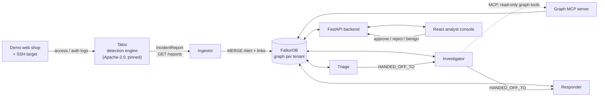
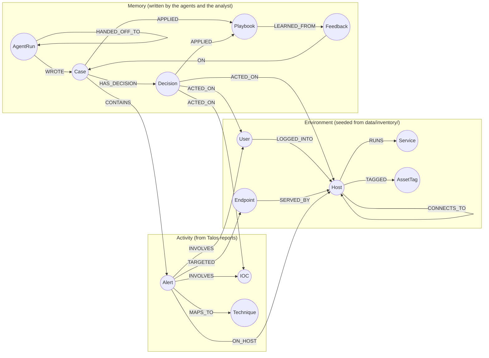

# Argus SOC

**A team of security agents that triage, investigate and respond to attacks by walking a FalkorDB graph, and remember every case and analyst verdict.**

Built for **Graph Hacks: Context for AI Agents** (WeMakeDevs × FalkorDB, Oct 15–18, 2026).

| | |
|---|---|
| **Tracks entered** | **Track 01: Agents That Act on Connected Data** and **Track 02: Agent Memory and Coordination** |
| **Demo video** | DEMO_VIDEO_LINK_HERE |
| **Live demo** | Analyst console: https://argus-soc.34-93-139-203.sslip.io · Demo web shop (attack target): https://shop.34-93-139-203.sslip.io |
| **Live demo login** | JUDGE_LOGIN_HERE |
| **Graph database** | FalkorDB, one graph per tenant (`tenant_acme`, `tenant_globex`) |
| **License** | [Apache-2.0](LICENSE) |

---

## The problem

A security operations centre (SOC) analyst sees one alert at a time. The real questions are about connections. Which other hosts touched this IP? Can an attacker get from this host to the production database? Have we seen this before and closed it as benign?

Argus SOC answers those questions with graph queries, and three agents act on the answers. Remove FalkorDB and the product stops working: there is nothing left to correlate alerts, find attack paths, rank hosts, remember past cases or hand work between agents.

## What it does

1. **[Talos](https://github.com/anandharshit712/Talos)**, our open-source detection engine, flags an attack (SSH brute force, credential stuffing, SQL injection, XSS) and produces an incident report.
2. The **ingestor** writes each report into the tenant's graph as an `Alert` linked to its hosts, users, IOCs, endpoints and MITRE techniques.
3. **Triage agent:** groups linked alerts into one `Case`, recalls past cases about the same IP, host or user, and auto-closes a pattern the analyst has already marked benign (learned `Playbook`).
4. **Investigator agent:** works out the blast radius (multi-hop query), finds attack paths to crown-jewel hosts (`algo.SPpaths`), then lets the LLM choose more read-only graph tools over **MCP** for a bounded deep dive.
5. **Responder agent:** ranks which host to isolate (`algo.betweenness` × criticality), picks an action from a fixed decision table, and explains why. High-impact actions wait for analyst approval.
6. **The analyst** approves, rejects or marks the case benign in the web UI. That verdict goes back into the graph as memory, and the next similar alert is handled differently.

Every decision is made in code from graph query results. The LLM is optional: it writes explanations and drives the MCP deep dive, but it never decides the action.

## Architecture



| Component | Tech | Code |
|---|---|---|
| Graph tools library (all Cypher) | Python, `falkordb` client | [`src/argus_soc/graph/`](src/argus_soc/graph/) |
| Ingestor (Talos to graph) | Python, `httpx` | [`src/argus_soc/ingestor/`](src/argus_soc/ingestor/) |
| Agents (Triage, Investigator, Responder) | Python, Anthropic or OpenAI SDK (optional), `mcp` | [`src/argus_soc/agents/`](src/argus_soc/agents/) |
| Graph MCP server | official `mcp` SDK, stdio | [`src/argus_soc/graph/mcp_server.py`](src/argus_soc/graph/mcp_server.py) |
| Backend API | FastAPI | [`backend/`](backend/) |
| Analyst console | React 19, TypeScript, Vite | [`ui/`](ui/) |
| Live demo harness (shop, SSH target, log shipper, attack bot) | Python, FastAPI | [`demo/`](demo/) |
| Deployment | Docker Compose, nginx, HTTPS | [`docker-compose.yml`](docker-compose.yml), [`deploy/`](deploy/) |

More detail: [docs/ARCHITECTURE.md](docs/ARCHITECTURE.md) (deployment, components, sequences, trust boundaries), [docs/HLD.md](docs/HLD.md), [docs/LLD.md](docs/LLD.md), [docs/DFD.md](docs/DFD.md), [docs/UI_PAGES.md](docs/UI_PAGES.md).

## Graph data model

One graph per tenant, in three layers: the **environment** (what exists), **activity** (what Talos saw) and **memory** (what the agents and analysts decided and learned).



| Label | Key | What it holds |
|---|---|---|
| `Host` | `hostname` | `ip`, `os`, `zone`, `criticality` 1–5, `isolated`; memory: `targeted_case_ids` |
| `User` | `username` | `role`, `department`, `privileged`, `disabled`; memory: `suspected_compromised` |
| `Service` | `name` | `port`, `exposed` |
| `Endpoint` | `path` + `app` | web paths Talos saw attacked |
| `AssetTag` | `name` | `crown-jewel` marks hosts an attacker must not reach |
| `Alert` | `incident_id` | category, severity, confidence, `succeeded`, evidence from Talos |
| `IOC` | `type` + `value` | `verdict` (unknown / malicious / benign), `seen_case_ids` |
| `Technique` | `mitre_id` | MITRE ATT&CK name and tactic |
| `Case` | `id` | status, priority, `claimed_by`, findings, verdict |
| `Decision` | `id` | rule, actions, reason, explanation, `outcome` (pending / approved / rejected / auto) |
| `Feedback` | `id` | analyst verdict and note |
| `Playbook` | `name` + `version` | learned condition and action, `active` |
| `AgentRun` | `id` | which agent and worker did what, tool calls, handoff |

Full model with every property, indexes and case statuses: **[src/argus_soc/graph/README.md](src/argus_soc/graph/README.md)**. A test ([`tests/graph/test_graph_readme.py`](tests/graph/test_graph_readme.py)) fails if that document drifts from the code.

## Cypher queries and graph algorithms the product depends on

All Cypher lives in [`src/argus_soc/graph/`](src/argus_soc/graph/). Every value is a query parameter, never string-built Cypher, and every write is a single idempotent `MERGE` query.

| # | Query | Used by | What it decides | Code |
|---|---|---|---|---|
| Q1 | **Blast radius** (multi-hop): IOC → alerts → hosts → accounts → every host those accounts log into | Investigator | how far the attack can spread | [`read_queries.py`](src/argus_soc/graph/read_queries.py) `blast_radius` |
| Q2 | **Paths to crown jewels**: FalkorDB **`algo.SPpaths`** over `CONNECTS_TO` and `LOGGED_INTO`, both directions | Investigator | whether a crown jewel is reachable; this drives the decision rule | [`algorithm_queries.py`](src/argus_soc/graph/algorithm_queries.py) `paths_to_crown_jewels` |
| Q3 | **Which host to isolate**: FalkorDB **`algo.betweenness`** on the host network, × criticality | Responder | the single best host to cut off | [`algorithm_queries.py`](src/argus_soc/graph/algorithm_queries.py) `rank_hosts` |
| Q4 | **Recall**: closed cases about the same IOCs, hosts or users | Triage | "have we seen this before, and what did the analyst say?" | [`read_queries.py`](src/argus_soc/graph/read_queries.py) `recall` |
| Q5 | **Linked alerts**: live alerts sharing an IOC or user | Triage | which alerts become one case | [`read_queries.py`](src/argus_soc/graph/read_queries.py) `linked_alerts` |
| Q6 | **Explain a decision**: decision → case → alerts → targets → playbook → the case it was learned from | UI, all agents | the "why" shown to the analyst | [`read_queries.py`](src/argus_soc/graph/read_queries.py) `explain_decision` |
| W | Ingest report, open or join case, claim case, record semantic facts, record feedback, create playbook version | all | shared state, memory and learning | [`write_queries.py`](src/argus_soc/graph/write_queries.py) |

Two of them, as they run:

```cypher
// Q2: attack paths from an alerted host to any crown-jewel host
MATCH (src:Host {hostname: $host}),
      (dst:Host)-[:TAGGED]->(:AssetTag {name: $tag})
WHERE dst <> src
CALL algo.SPpaths({sourceNode: src, targetNode: dst,
                    relTypes: ['CONNECTS_TO', 'LOGGED_INTO'],
                    relDirection: 'both', maxLen: $max_hops, pathCount: $count})
YIELD path
RETURN [n IN nodes(path) | coalesce(n.hostname, n.username)] AS names, length(path) AS hops
```

```cypher
// Q3: which host many attack paths cross
CALL algo.betweenness({nodeLabels: ['Host'], relationshipTypes: ['CONNECTS_TO']})
YIELD node, score
WHERE node.hostname IN $hosts
RETURN node.hostname AS host, score
```

Every query in full, with what it returns on the demo data: [src/argus_soc/graph/README.md §4](src/argus_soc/graph/README.md#4-the-queries).

### How graph results become actions

The Responder's decision table ([`decision_table.py`](src/argus_soc/agents/decision_table.py)) is plain code keyed on two graph findings: did the attack succeed, and does a path reach a crown jewel (Q2)?

| Rule | Succeeded | Path to crown jewel | Actions | Needs approval |
|---|---|---|---|---|
| R1 | yes | yes | isolate the top-ranked host (Q3), disable accounts, block IPs | yes |
| R2 | yes | no | disable accounts, block IPs, open a hunt ticket | yes |
| R3 | no | yes | block IPs, watch the hosts on the path | no (yes if the IP is already known malicious) |
| R4 | no | no | block or rate-limit IPs, open a ticket, lower priority one step | no |

Actions on hosts and accounts are simulated: they set `isolated` / `disabled` in the graph and are shown in the UI.

## How it covers the tracks

**Track 01: Agents That Act on Connected Data**

| Focus | Where |
|---|---|
| Multi-hop reasoning | Q1 blast radius, Q2 attack paths, Q6 explanation |
| Graph queries and algorithms as agent tools | `algo.SPpaths` (Investigator), `algo.betweenness` (Responder) |
| Tool selection through MCP | Investigator deep dive: the LLM picks from six read-only graph tools ([`mcp_server.py`](src/argus_soc/graph/mcp_server.py), [`graph_tool_client.py`](src/argus_soc/agents/graph_tool_client.py)) |
| Actions based on graph results | decision table R1–R4 above |
| Explainable results | each `Decision` stores its rule, reason and evidence; Q6 shows the full chain in the UI |

**Track 02: Agent Memory and Coordination**

| Focus | Where |
|---|---|
| Episodic memory | closed `Case`s with alerts, verdict and analyst notes, read back by Q4 recall |
| Semantic memory | facts on nodes: `Host.targeted_case_ids`, `User.suspected_compromised`, `IOC.verdict` |
| Procedural memory | `Playbook` versions `LEARNED_FROM` analyst feedback; "mark benign" makes the next matching case auto-close and cite where it learned this |
| Persistence across sessions | FalkorDB with append-only file on a volume; agents keep nothing in process, so a restarted agent carries on from the graph |
| Shared state and handoffs | `Case.status` + `claimed_by` / `claimed_at` (expiring claims), `AgentRun -[:HANDED_OFF_TO]-> AgentRun` chain |
| High-concurrency reads and writes | `--scale agents=2`; scenario 5's burst (31 incidents over both tenants) gives exactly one decision per case and no alert in two cases ([`tests/e2e/test_concurrency_burst.py`](tests/e2e/test_concurrency_burst.py)) |
| Separate memory per tenant | one FalkorDB graph per tenant; `tenant` is the first argument of every graph function; the same attacker IP is new to Globex even after Acme has learned about it |

## Run it locally

Prerequisites: Docker with Docker Compose v2, Git, Python 3.11+ (only for the replay script and tests).

**1. Clone and configure**

```bash
git clone https://github.com/anandharshit712/Argus-SOC.git
cd Argus-SOC
cp .env.example .env
grep -E '^ARGUS_(DEMO_USERS|SESSION_SECRET|SESSION_HOURS)=' backend/.env.example >> .env
```

Then edit `.env`:

- `TALOS_DB_PASSWORD`: any long random value.
- `ARGUS_SESSION_SECRET`: at least 32 random characters, e.g. `python -c "import secrets; print(secrets.token_urlsafe(48))"`.
- `ARGUS_DEMO_USERS`: replace the placeholder passwords. You sign in to the UI as `acme.analyst`, `globex.analyst` or `demo.admin` (both tenants).
- Optional, for LLM explanations and the MCP deep dive: `LLM_ENABLED=true`, `LLM_API_KEY`, `LLM_PROVIDER` (`anthropic` or `openai`) and `LLM_MODEL`. With the LLM off, every decision is still made and explanations use templates.

**2. Start the stack**

```bash
docker compose --profile app up -d --build
```

This starts FalkorDB, seeds both tenants (indexes and asset inventories), builds Talos at its pinned commit, and starts the ingestor, agents, API, UI and nginx.

- Analyst console: http://127.0.0.1:8088
- FalkorDB Browser: http://127.0.0.1:3000 (graph `tenant_acme` or `tenant_globex`)

Two agent workers, to see the shared-state coordination: `docker compose --profile app up -d --scale agents=2`.

On Windows, Compose v5 `up --build` can fail ("additional privileges requested"). Use `.\run_scenario.ps1`, which builds and starts the stack for you, or build the images with `docker build -f deploy/<x>.Dockerfile` and start with `docker compose --profile app up -d --no-build`.

**3. Run the demo scenarios** (fixed, synthetic log files replayed into Talos)

```bash
python scripts/replay_scenario.py --demo      # the whole demo, step by step, pausing for analyst actions
python scripts/replay_scenario.py 1           # one scenario: brute force that lands
python scripts/replay_scenario.py 5 --burst   # concurrency burst
python scripts/replay_scenario.py --reset     # empty Talos and the tenant graphs first
```

Windows: `.\run_scenario.ps1 -Demo`, `.\run_scenario.ps1 1`, `.\run_scenario.ps1 5 -Burst`.

| Scenario | Tenant | What it shows |
|---|---|---|
| 0 Quiet morning | both | a normal hour at both companies, nothing malicious (control) |
| 1 Brute force lands | Acme | SSH brute force succeeds on `bastion-01`, then credential stuffing from the same IP; one case, path to `db-prod-01`, rule R1 |
| 2 Scheduled scanner | Acme | internal pentest scanner; analyst marks it benign, and the next run is auto-closed by the learned playbook |
| 3 SQLi blocked | Acme | injection with no path to a crown jewel; R4 lowers the priority |
| 4 Second organisation | Globex | the same attacker IP is new to Globex: tenant isolation |
| 5 Busy hour | both | 24 attack bursts over both tenants at once (31 Talos incidents) |
| 6 Account returns | Acme | a week later, a new IP guesses `svc_deploy`'s password; priority is raised because the graph remembers the account as suspected compromised |

**4. Live attacks (optional)**: a small, deliberately attackable shop and SSH target that feed Talos continuously.

```bash
docker compose -f docker-compose.yml -f demo/docker-compose.demo.yml --profile demo up -d
curl -X POST "http://127.0.0.1:8090/launch?attack=web_brute&outcome=pass"   # web_brute | cred_stuffing | sqli | xss | ssh_brute
curl http://127.0.0.1:8090/selfcheck
```

The attack bot only targets the bundled demo containers. See [demo/README.md](demo/README.md).

**5. Tests**

```bash
pip install -e ".[dev]"
pytest -rs        # tests marked falkordb need the stack's FalkorDB on 127.0.0.1:6379
```

The cloud deployment (GCP VM, HTTPS, one-command deploy script) is described in [deploy/gcp_runbook.md](deploy/gcp_runbook.md).

## Data

All data is synthetic or our own. The asset inventories for the two fictional companies, Acme and Globex, are in [`data/inventory/`](data/inventory/). The scenario logs are in [`data/scenarios/`](data/scenarios/). Live-demo attacker addresses use RFC 5737 documentation ranges, and the demo accounts are dummies. No private, personal or restricted data is used.

## Built on Talos, and what we built during the event

**Talos** ([github.com/anandharshit712/Talos](https://github.com/anandharshit712/Talos), Apache-2.0) is an attack-detection engine that Harshit built before this hackathon. Argus SOC uses it as an external dependency:

- It is built from the public repo at a pinned commit (`172866b`, see [`deploy/talos/Dockerfile`](deploy/talos/Dockerfile)) and is never copied into this repo.
- Argus SOC only calls its HTTP API (`GET /reports`, `GET /reports/{id}`, `POST /events`).
- Talos's detection code was not changed during the event. Its last code change was before Oct 15; the only Talos commit during the event added optional Docker packaging.
- Argus SOC pushes nothing back into Talos.

**From Talos:** the detectors (SQLi, XSS, web brute force, SSH/RDP brute force, credential stuffing), log parsers, MITRE mapping, confidence and evidence.

**Built during the event (Oct 15–18, 2026)**, everything in this repo:

- the FalkorDB graph model, indexes, per-tenant graphs and all Cypher queries and algorithm calls (Q1–Q6 and the writes)
- the Talos-to-graph ingestor and tenant routing
- the three agents, the decision table, handoffs and expiring case claims
- the memory layer: recall, semantic facts, feedback and versioned playbooks
- the graph MCP server and the Investigator's LLM deep dive
- the FastAPI backend and the React analyst console
- the asset inventories, scenario logs, replay script and live demo harness
- the Docker Compose stack, Talos Dockerfile, nginx/HTTPS and GCP deployment

The first commit is on Oct 15, 2026 (IST); see the git history.

## Use of AI coding assistants

We used **Claude Code** (Anthropic) throughout the build, as the hackathon rules allow. All three of us used it, for:

- drafting and refactoring code, tests and documentation
- reviewing Cypher queries against the FalkorDB docs
- debugging the Docker and deployment setup

The team designed the graph model, agents, decision rules and architecture; the design docs in [`docs/design/`](docs/design/) were written before any code. We reviewed every change and verified it with unit tests, live tests against FalkorDB and end-to-end runs of every scenario. The rules we gave the assistant are in [`CLAUDE.md`](CLAUDE.md), [`RULESET.md`](RULESET.md) and [`PROJECT_GUIDELINES.md`](PROJECT_GUIDELINES.md).

Separately, at runtime the agents can call an LLM (Anthropic or OpenAI; the live demo uses OpenAI) to write explanations and choose MCP graph tools. The action itself is always chosen by the decision table, never by the LLM.

## Team

| Member | Workstream |
|---|---|
| Harshit Anand | Workstream A: agents, Talos integration, ingestor, live demo harness, deployment |
| Md Adnan Afzal | Workstream B: FalkorDB graph model, Cypher queries and algorithms, graph MCP server, Docker Compose |
| Satya Prakash Nirala | Workstream C: backend API and analyst console (UI) |

## License

[Apache License 2.0](LICENSE). Talos is a separate project under its own Apache-2.0 license.
