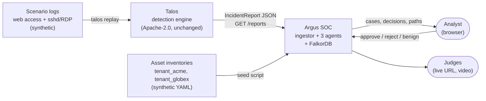
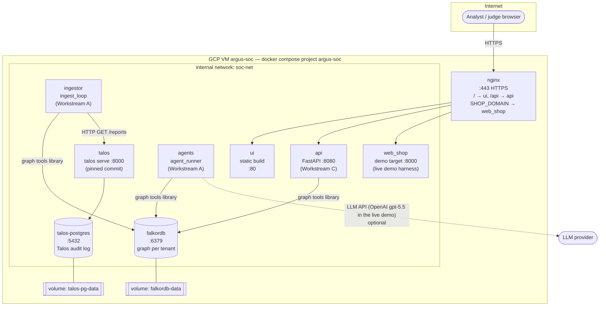
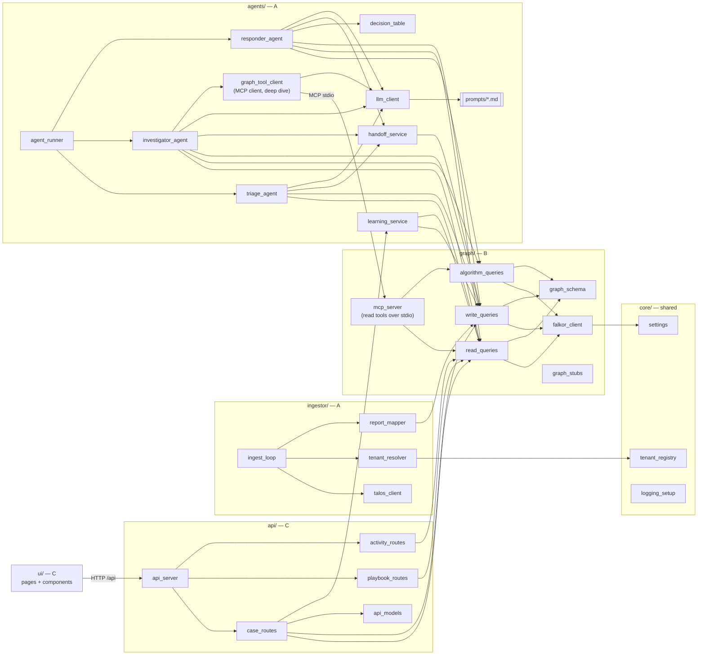
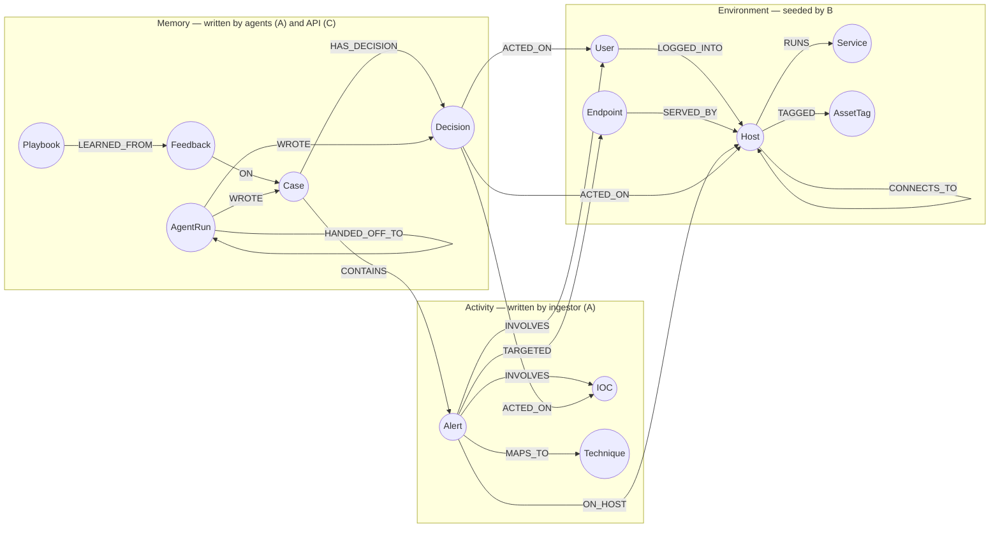
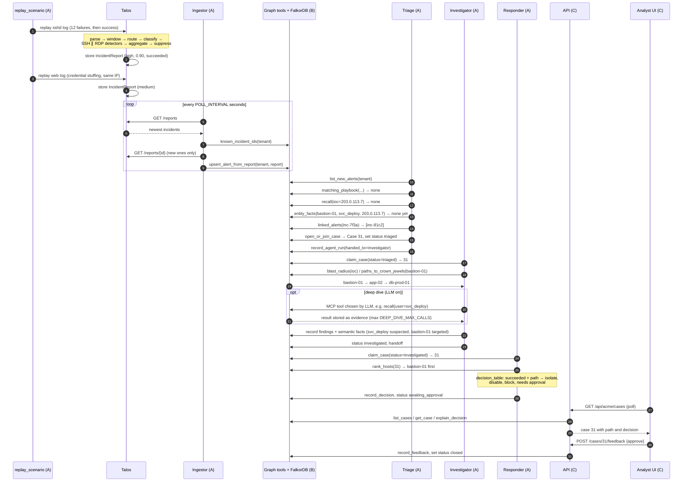
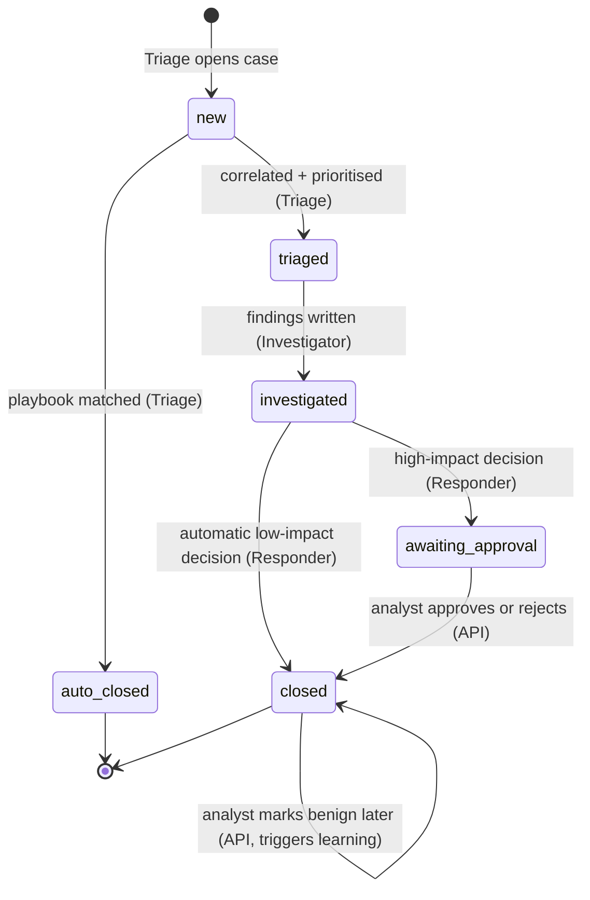
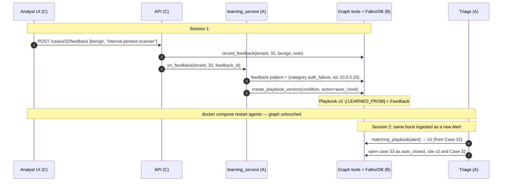
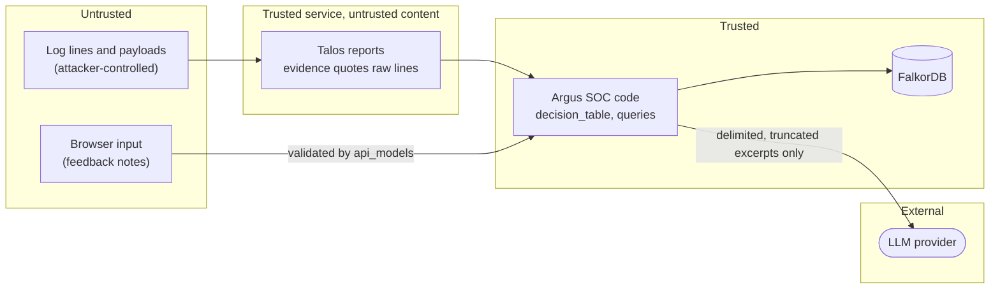

# Argus SOC — Architecture

Diagrams of the whole system: context, deployment, components, graph schema, runtime sequences
and the case lifecycle. Diagrams are Mermaid and render on GitHub. Detail behind each one is in
`HLD.md`, `LLD.md` and `DFD.md`.

## 0. Who works on what in this document

| Section | Owner | What to take from it |
|---|---|---|
| 1. System context | Everyone | The big picture; read first |
| 2. Deployment view | **B — Database and graph** | Services, ports, network and volumes for `docker-compose.yml` and the GCP VM |
| 3. Component view: `ingestor/`, `agents/`, `deploy/talos/` | **A — Harshit** | Modules you build and what they call |
| 3. Component view: `graph/`, `core/` | **B — Database and graph** | Modules you build and who calls them |
| 3. Component view: `api/`, `ui/` | **C — UI, API and submission** | Modules you build and what they call |
| 4. Graph schema | **B** owns; **A** and **C** read | Labels and relationships every query uses |
| 5. Scenario 1 sequence | **A** owns the flow; **B** and **C** check their calls | The end-to-end run due by end of Oct 16 |
| 6. Case lifecycle | **A** owns; **C** displays it | Status values and who moves a case between them |
| 7. Learning loop sequence | **A** (learning logic), **C** (feedback UI) | Scenario 2 |
| 8. Trust boundaries | Everyone | What is untrusted and what stays private |

Owners: **A** = Agents + Talos integration (Harshit) · **B** = Database and graph (Md Adnan Afzal) ·
**C** = UI, API and submission (Satya).

---

## 1. System context

Talos detects. Argus SOC connects, remembers and decides. The analyst approves.

---

## 2. Deployment view (Docker Compose on the GCP VM)

One Compose project. Only nginx is reachable from the internet. Talos, its PostgreSQL and
FalkorDB stay on the internal network.

Since Oct 17, 2026 it runs on one GCP Compute Engine VM (`argus-soc`, e2-standard-4, asia-south1,
static IP 34.93.139.203) instead of OCI (HLD D14). nginx serves the UI and API at `ARGUS_DOMAIN` and
the demo web shop at `SHOP_DOMAIN` (free sslip.io names); the rest of the live demo harness
(attack-bot, SSH target, log shipper) stays on `soc-net`. Steps: `deploy/gcp_runbook.md`.

| Service | Built from | Port (internal) | Exposed | Depends on | Owner |
|---|---|---|---|---|---|
| `nginx` | `deploy/nginx/` | 443 | **yes** | ui, api | B |
| `ui` | `deploy/ui.Dockerfile` | 80 | via nginx | — | C |
| `api` | `deploy/api.Dockerfile` | 8080 | via nginx `/api` | falkordb | C |
| `agents` | `deploy/agents.Dockerfile` (`agent_runner`) | — | no | falkordb | A |
| `ingestor` | `deploy/agents.Dockerfile` (`ingest_loop`) | — | no | falkordb, talos | A |
| `falkordb` | `falkordb/falkordb` image | 6379 | no | — | B |
| `talos` | `deploy/talos/Dockerfile` | 8000 | no | talos-postgres | A |
| `talos-postgres` | `postgres:16` image | 5432 | no | — | B |
| `web_shop` (+ `ssh_target`, `shipper`, `attack_bot`) | `demo/` (`demo/docker-compose.demo.yml`) | 8000 | shop only, via nginx `SHOP_DOMAIN` | talos | A |

---

## 3. Component view (inside the repo)

Arrows mean "calls". Nothing outside `graph/` talks to FalkorDB directly (rule A1).

Note: the feedback route calls `learning_service` so that a benign verdict turns into a playbook
straight away. That one call crosses from C into A, so its signature is part of the contracts.

---

## 4. Graph schema (one graph per tenant)

Properties for every label are listed in `LLD.md` §4.1.

---

## 5. Runtime sequence — scenario 1 (brute force that lands)

---

## 6. Case lifecycle

| Status | Set by | Next owner |
|---|---|---|
| `new` | Triage, when it opens the case | Triage (same step) |
| `triaged` | Triage | Investigator |
| `investigated` | Investigator | Responder |
| `awaiting_approval` | Responder | Analyst (UI) |
| `closed` | Responder (automatic actions) or API (analyst verdict) | — |
| `auto_closed` | Triage (playbook match) | — |

A case also stores `claimed_by` and `claimed_at`, so two workers never take the same case
(see `LLD.md` §6.1).

---

## 7. Learning loop — scenario 2

---

## 8. Trust boundaries

- Anything quoted from logs is data. It never becomes an instruction, a Cypher fragment or a shell
  argument. Queries always use parameters.
- Only nginx is public. Talos has no authentication, so it stays internal.
- The API requires a signed session token on every `/api/{tenant}/…` call (GAP-1, proposed).
  Hackathon users are hard-coded in `.env` (HLD D13); no analyst account data is stored in
  FalkorDB. The feedback author comes from the token, not from browser input.
- The LLM receives short, delimited excerpts, never the whole graph or secrets.
