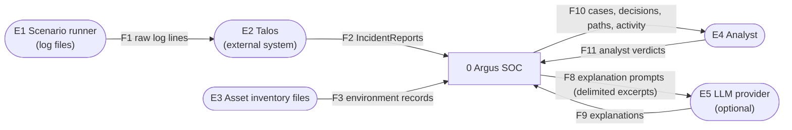
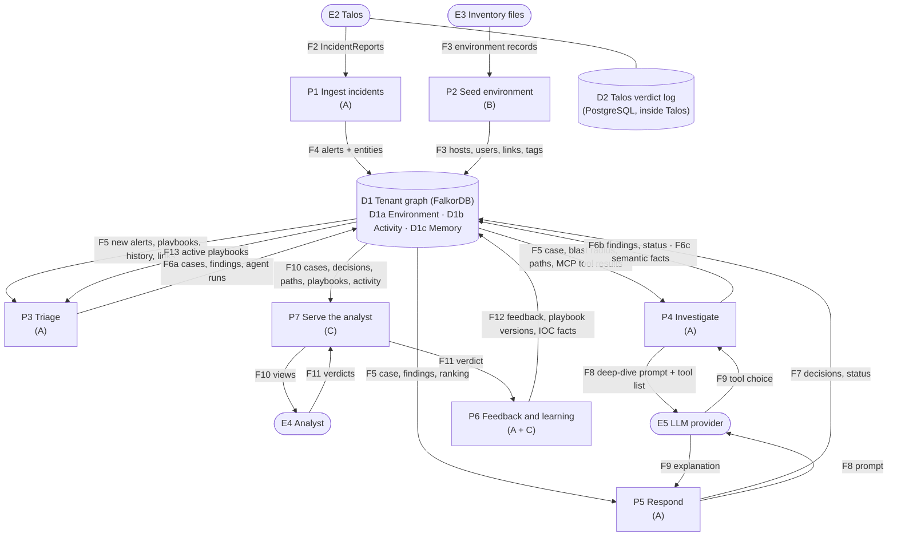
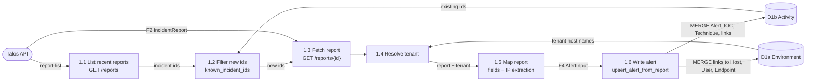
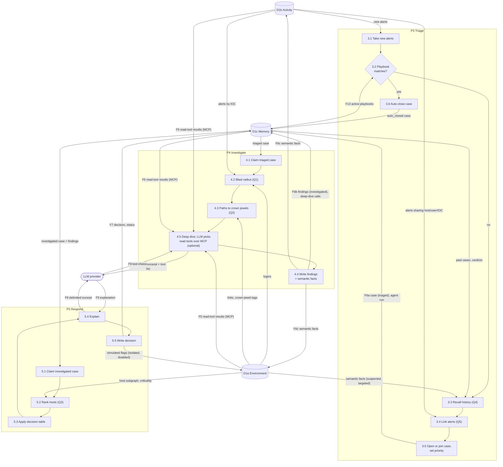
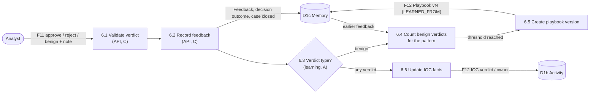
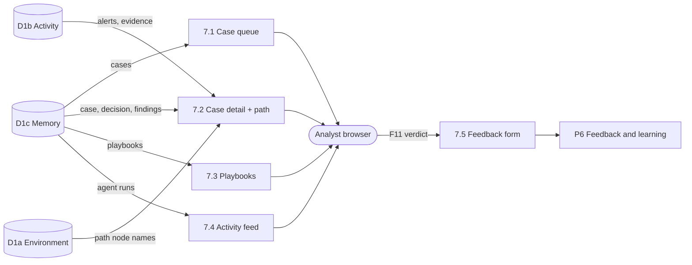

# Argus SOC — Data Flow Diagrams (DFD)

Where data comes from, what transforms it, where it is stored and who reads it. Level 0 is the
whole system, Level 1 its main processes, Level 2 opens up the busiest ones. The data dictionary
at the end defines every flow.

Notation in the Mermaid diagrams: rectangles are **processes** (numbered), cylinders are **data
stores** (D-numbered), rounded boxes are **external entities**.

## 0. Who works on what in this document

| Section | Owner | What to check |
|---|---|---|
| 1. Level 0 context | Everyone | System boundary |
| 2. Level 1 | Everyone; each process names its owner | Which process you own and its inputs and outputs |
| 3. Level 2 — P1 Ingest incidents | **A — Harshit** | Talos → graph mapping |
| 4. Level 2 — Talos detection (external, for reference) | **A** | How the IncidentReport is produced |
| 5. Level 2 — P3–P5 Agents | **A** | What each agent reads and writes |
| 6. Level 2 — P6 Feedback and learning | **A** (learning), **C** (feedback capture) | The memory update loop |
| 7. Level 2 — P7 Serve the analyst | **C — UI, API and submission** | What the UI reads and writes |
| 8. Data stores | **B — Database and graph** | D1 layout, retention, who writes what |
| 9. Data dictionary | **B** keeps it current; A and C add their flows | Field-level definitions |
| 10. Trust and sensitivity | Everyone | Untrusted data and what must stay private |

Owners: **A** = Agents + Talos integration (Harshit) · **B** = Database and graph (Md Adnan Afzal) ·
**C** = UI, API and submission (Satya).

---

## 1. Level 0 — context

Talos is drawn as external: we run it but do not change it.

---

## 2. Level 1 — main processes

| Process | Owner | Input flows | Output flows | Runs |
|---|---|---|---|---|
| P1 Ingest incidents | A | F2 | F4 | Loop every 3 s |
| P2 Seed environment | B | F3 | F3 into D1a | Once, and on reset |
| P3 Triage | A | F5, F13 | F6a | Loop every 2 s, per tenant |
| P4 Investigate | A | F5, F9 | F6b, F6c, F8 | Per claimed case |
| P5 Respond | A | F5, F9 | F7, F8 | Per claimed case |
| P6 Feedback and learning | A (logic), C (capture) | F11 | F12 | On each verdict |
| P7 Serve the analyst | C | F10, F11 | F10, F11 | On request; UI polls every 2–3 s |

---

## 3. Level 2 — P1 Ingest incidents (A)

---

## 4. Level 2 — Talos detection (external, for reference)

How Talos turns F1 into F2. This runs inside Talos; we do not change it.

```mermaid
flowchart LR
    F1(["F1 raw log line"])
    T1["Parse<br/>→ NormalizedEvent"]
    T2[("Event window<br/>(recent events)")]
    T3["Route by domain"]
    T4["Classify attack type<br/>(static first, model if unsure)"]
    T5["Sub-agent:<br/>detectors in parallel"]
    T6["Aggregate verdicts<br/>severity, confidence, actions"]
    T7["Suppress repeats<br/>unless escalated"]
    D2[("D2 Talos verdict log")]
    OUT(["F2 IncidentReport<br/>GET /reports"])

    F1 --> T1 --> T2 --> T3 --> T4 --> T5
    T2 -. "windowed counts" .-> T5
    T5 -- "Verdicts" --> T6 --> T7 --> D2 --> OUT
```

---

## 5. Level 2 — P3 Triage, P4 Investigate, P5 Respond (A)

---

## 6. Level 2 — P6 Feedback and learning (A logic, C capture)

---

## 7. Level 2 — P7 Serve the analyst (C)

---

## 8. Data stores

| Store | Technology | Contents | Written by | Read by | Kept |
|---|---|---|---|---|---|
| D1a Environment | FalkorDB, per-tenant graph | Host, User, Service, Endpoint, AssetTag and links | P2 (seed), P4 (semantic facts), P5 (simulated flags) | P1, P3, P4, P5, P7 | Until reset |
| D1b Activity | same graph | Alert, IOC, Technique and links | P1, P4 (IOC seen in cases), P6 (IOC facts) | P3, P4, P7 | Until reset |
| D1c Memory | same graph | Case, Decision, Feedback, Playbook, AgentRun | P3, P4, P5, P6 | P3–P7 | Until reset; survives restarts |
| D2 Talos verdict log | PostgreSQL inside Talos | Talos IncidentReports | Talos | Talos API only | Talos's own |

D1a–D1c are logical areas of one graph per tenant (`tenant_acme`, `tenant_globex`). Nothing flows
between tenant graphs.

---

## 9. Data dictionary

| Flow | Name | Fields | Producer → consumer |
|---|---|---|---|
| F1 | Raw log line | text line in nginx access or sshd/RDP format | Scenario runner → Talos |
| F2 | IncidentReport | `incident_id`, `created_at`, `domain`, `category`, `summary`, `severity`, `confidence`, `verdicts[]` (detector, technique, confidence, evidence[], scope, reasoning, model), `aggregate_scope` (affected_accounts, affected_endpoints, affected_objects, affected_hosts, attempt_count, source_diversity, succeeded, window_start, window_end), `mitre_techniques[]` (technique_id, technique_name, tactic), `recommended_actions[]` | Talos → P1 |
| F3 | Environment record | hosts (hostname, ip, zone, criticality, tags), users (username, role, privileged, logs_into), links (from, to, port), known IOCs | Inventory YAML → P2 → D1a |
| F4 | AlertInput | incident_id, domain, category, severity, confidence, succeeded, summary, talos_created_at, hosts[], users[], endpoints[], techniques[], source_ips[], evidence[], recommended_actions[] | P1 → D1b |
| F5 | Agent read set | per query: Q1 blast radius rows, Q2 paths, Q3 ranking, Q4 history, Q5 linked ids, case detail | D1 → P3/P4/P5 |
| F6a | Triage output | Case (id, status=triaged, priority), CONTAINS links, findings.recall, findings.linked, AgentRun | P3 → D1c |
| F6b | Investigation output | findings.succeeded, findings.path_to_crown_jewel, findings.shortest_path, findings.blast_radius, findings.deep_dive (tool, args, result, why), status=investigated, AgentRun (worker, tool_calls) | P4 → D1c |
| F6c | Semantic facts | Host targeted_case_ids, last_targeted_at; User suspected_compromised, suspected_at, suspect_case_id; IOC seen_case_ids | P4 → D1a, D1b; read by P3 |
| F7 | Decision | id, rule_id, actions[], targets, needs_approval, reason, explanation, evidence (query results), outcome, status | P5 → D1c |
| F8 | Explanation prompt | prompt name, case summary, rule, ranking, delimited evidence excerpts (≤ 500 chars each) | P5 → LLM |
| F9 | Explanation | text ≤ 1,000 chars, or none (template used) | LLM → P5 |
| F10 | Analyst view | CaseSummary, CaseDetail (alerts, findings, decision, path, ranking, feedback, agent runs), PlaybookOut, ActivityItem | D1 → P7 → Analyst |
| F11 | Analyst verdict | tenant, case_id, verdict (approve/reject/benign), note ≤ 500 chars, analyst | Analyst → P7 → P6 |
| F12 | Learning output | Feedback node, Decision outcome, Playbook (name, version, condition, action, active), IOC verdict/owner | P6 → D1 |
| F13 | Active playbooks | name, version, condition (category, ioc_in), source case | D1c → P3 |

---

## 10. Trust and sensitivity

| Data | Trust level | Handling |
|---|---|---|
| F1 log lines, evidence inside F2 | **Untrusted** (attacker-controlled) | Never executed or followed; parameterised queries only; delimited and truncated before any prompt; truncated in logs |
| F11 analyst notes | Untrusted input | Validated by `api_models` (length, type); stored as text only |
| F8 prompts | Leaves the system | Only short excerpts; no secrets, no whole graph |
| D2 Talos log | Internal | Talos port never published |
| D1 tenant graphs | Internal, isolated | One graph per tenant; FalkorDB port never published |
| Secrets (LLM key, DB passwords) | Secret | `.env` only, never in git or logs |

All scenario data is synthetic; external addresses use documentation IP ranges.
