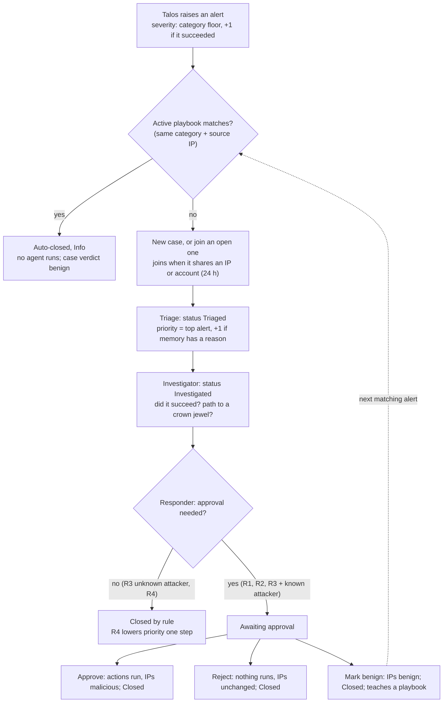

# Argus SOC: Manual Test Guide (GCP deployment)

Oct 17, 2026 · Harshit Anand · local copy of the Claude Doc https://claude.ai/code/artifact/028cb572-68d7-4568-bd21-708bde753895 (the doc is the live version)

## How to use this guide

This guide lets any of us drive the attacker by hand, predict what Argus should do with each attack, and mark the result pass or fail. Every rule below was read from the code on `origin/main` at commit `53c9e04` (Oct 17), not from the design docs.

**Before testing:** the VM still runs an older commit (`6160258`), which does not have the fixes for the late-success re-decision, R3 approval for known attackers, or injection endpoint rotation. Do Setup step 0 first, or some results in this guide will not match.

| What | Where |
| --- | --- |
| Argus UI (analyst console) | https://argus-soc.34-93-139-203.sslip.io |
| Argus API health | https://argus-soc.34-93-139-203.sslip.io/api/health |
| Demo web shop (the target) | https://shop.34-93-139-203.sslip.io |
| Attack bot (VM only, not public) | `http://localhost:8090` from an SSH session on the VM |
| Project folder on the VM | `/opt/Argus-SOC` (shortcut `~/Argus-SOC`) |
| Test helper scripts on the VM | `/opt/Argus-SOC/local_tools/` (not in git) |
| Argus logins | `ARGUS_DEMO_USERS` in `.env`; ask Harshit, never paste them in chat |

All demo traffic belongs to tenant **acme**: the shop logs as host `web-01` and the SSH target as `bastion-01`, both acme hosts. Log in as an acme user, or you will see an empty queue.

**What to watch while a test runs:**

- **Case Queue** (`/cases`): a new row appears within about 5 to 60 seconds. Watch its Status and Priority badges change.
- **Case detail** (`/cases/<id>`): the Case progress strip (Triage, Investigator, Responder, Analyst or Playbook), the Decision Panel, Path to Crown Jewel, Memory and the Feedback tab.
- **Playbooks** (`/playbooks`): new versions appear after a Mark benign verdict.
- **Activity** (`/activity`): one line per agent step.
- **VM terminal:** `sh local_tools/cases.sh acme` prints every case with its status, priority, rule and IOCs.

## Setup

Setup takes about 10 minutes: deploy the latest code, check the stack, open the UI, and choose a light or full reset.

**Step 0: deploy the latest code (once, about 5 minutes).**

The one-command path does the whole deploy — pull, build, start, health check — and is idempotent, so it is also the update path:

```bash
ssh argus                      # your own SSH alias
sudo /opt/Argus-SOC/deploy/deploy_gcp.sh
```

On the very first run on a bare VM it provisions the host and writes a `.env` skeleton, then stops so you can fill the secrets; run it again to build and start. On an already-set-up VM it just pulls, builds and restarts. See `deploy/gcp_runbook.md` for what it automates.

Manual path (if you want to drive it by hand): two files that live in git were once copied to the VM by hand, so move them aside first or `git pull` refuses.

```bash
cd /opt/Argus-SOC
mkdir -p /tmp/pre-pull && mv docker-compose.public-shop.yml deploy/nginx/oci/web-shop.conf.template /tmp/pre-pull/ 2>/dev/null || true
git pull                       # should land on b458309 (attack-bot v2) or later
git log -1 --oneline
dc up -d --build --scale agents=2
```

**Step 1: check the stack.**

```bash
dc ps                          # 13 running: 2 agents, api, ui, nginx, ingestor, talos, talos-postgres, falkordb, web_shop, ssh_target, shipper, attack_bot
curl -s localhost:8090/health  # {"status":"ok","mode":"demo"}
dc logs --tail 20 agents | grep -i llm   # no "LLM cannot be used" error
```

**Step 2: open the screens.** Sign in to the Argus UI as an acme user, open the Case Queue, and keep a second tab on the Dashboard. Logins live per tab (session storage), so sign in again in every new tab.

**Step 3: pick a reset.**

- **Light (no reset):** keep the existing cases. Expect the "already targeted" priorities in the Priority section, because `web-01` and `bastion-01` have been hit many times already.
- **Full reset (clean slate):** use this when you want the "fresh graph" priorities and an empty queue. The Talos step matters: wiping only the graph makes the ingestor pull Talos's 50 latest reports back in as new alerts.

```bash
dc stop ingestor agents
dc exec -T talos-postgres psql -U talos -d talos -c 'TRUNCATE verdict_log;'   # Talos's stored reports (not yet run on this VM)
dc restart talos                                                              # clears Talos's 1 h repeat memory
dc run --rm seed python scripts/reset_demo.py --yes                           # wipes and reseeds the Argus graphs
dc up -d --scale agents=2
```

**Helper scripts** in `/opt/Argus-SOC/local_tools/` (every team member can run them):

| Command | What it does |
| --- | --- |
| `sh local_tools/land.sh web <ip>` | 11 wrong web logins, then the valid demo login, all from `<ip>`: a web brute force that succeeds |
| `sh local_tools/land.sh webfail <ip> <account>` | 12 wrong web logins from `<ip>` against `<account>`: a failed brute force from an IP you choose |
| `sh local_tools/land.sh ssh x [account]` | 8 wrong SSH passwords, then the right one (default account `svc_deploy`): an SSH break-in on `bastion-01` |
| `sh local_tools/cases.sh acme` | Every acme case: id, status, priority, category, succeeded, IOCs, rule, opened and updated times |

Use documentation-range IPs only (`192.0.2.x`, `198.51.100.x`, `203.0.113.x`). The random campaigns use `198.51.100.10–59` and `203.0.113.10–59`, so pick a `192.0.2.x` address for a guaranteed new attacker.

## The attacker

The attack bot has two generations. **v1** (this section) only sends traffic that crosses one Talos detector threshold, and every campaign it runs **fails**; successful attacks then come from the `land.sh` helper. **v2** (next section, now in `main` at `b458309`) adds random **passes** straight from the bot — no helper script — so once the VM is on the latest code (Setup step 0) a pass is just `outcome=pass`.

**Demo mode (one attack on demand).** Run this on the VM. The call blocks until the campaign ends, then waits up to 20 s for Talos to raise the incident.

```bash
curl -s -X POST "localhost:8090/launch?attack=sqli" | python3 -m json.tool
# attack = web_brute | cred_stuffing | sqli | xss | ssh_brute
curl -s localhost:8090/selfcheck | python3 -m json.tool   # last 100 runs: detected yes/no, incident id, latency
```

The answer names the expected incident (`injection/high`), whether Talos raised it (`detected`), the `incident_id` and `latency_s`. If `detected` is false, Argus gets nothing for that run (see Known issues).

| Campaign | What it sends | Target host | Talos incident | Source IP (the IOC) | Rotates each run |
| --- | --- | --- | --- | --- | --- |
| `web_brute` | 12 wrong logins to one account in about 7 s | web-01 | auth\_failure, medium, not succeeded | random from the 100-IP pool | a new `victimN@mail.example` |
| `cred_stuffing` | 18 accounts, one wrong login each | web-01 | auth\_failure, medium; one incident at the 15th account and one more per account after (up to 4) | random, one IP for all 18 | new `custN@mail.example` accounts |
| `sqli` | 5 SQL injection probes, WAF answers 403 | web-01 | injection, high, not succeeded | random | endpoint, 6 in a cycle |
| `xss` | 3 XSS probes, WAF answers 403 | web-01 | injection, high, not succeeded | random | endpoint, 6 in a cycle |
| `ssh_brute` | 10 wrong SSH passwords | bastion-01 | network\_brute\_force, medium, not succeeded | always the attack\_bot container IP (`172.18.0.x`) | a new account such as `deploy7` |

**Random mode (soak).** A background loop picks a campaign by weight (web\_brute 3, ssh\_brute 3, cred\_stuffing 2, sqli 2, xss 2), runs it, then waits a random 45 to 180 s. Normal shop searches trickle underneath all the time in both modes; they never trip a detector.

```bash
sed -i 's/^DEMO_SOAK=.*/DEMO_SOAK=1/' .env && dc up -d attack_bot   # start
curl -s localhost:8090/health                                       # "mode":"soak"
dc logs -f attack_bot | grep -E "launching|DETECTED|MISSED"        # what it picked, and Talos's answer
sed -i 's/^DEMO_SOAK=.*/DEMO_SOAK=0/' .env && dc up -d attack_bot   # stop, back to demo mode
```

`DEMO_SOAK=1 dc up -d` on one line does not work: `dc` runs through `sudo`, which drops the variable. Edit `.env` as shown.

**Successful attacks (manual, `land.sh`).**

- **Web brute force that lands:** `sh local_tools/land.sh web 192.0.2.60`. Talos raises two incidents from that IP: auth\_failure/medium at the 10th failure, then auth\_failure/high succeeded on the valid login.
- **SSH brute force that lands:** `sh local_tools/land.sh ssh x`. Talos raises network\_brute\_force/medium at the 8th failure, then network\_brute\_force/high succeeded. Source IP is the attack\_bot container IP, whatever you pass.
- **One success per account per hour.** Talos stays silent about a second successful break-in on the same account within 1 h. For a second SSH break-in, create a spare account first: `dc exec ssh_target sh -c 'id ops_admin || useradd -m ops_admin; echo "ops_admin:<pick-a-password>" | chpasswd'`, then `SP='<that password>' sh local_tools/land.sh ssh x ops_admin`. The account is lost whenever `ssh_target` is recreated.

**By hand in a browser.** The public shop works too, for example a wrong login posted to `/login` or a search for `1' UNION SELECT NULL--`. The shop trusts `X-Forwarded-For` only from the bot, so every browser attack carries the nginx container's internal IP as its source, the same IOC for everyone.

## Attack bot v2: random pass and fail

v2 is built and merged to `main` (`b458309`). Once the VM is on that code (Setup step 0), every campaign can fail or pass: exactly 3 passes in every 10 soak runs, in random order, and soak runs until someone stops it. Passes come from the bot itself (`outcome=pass`), not from `land.sh`. Full design and e2e result: `demo/docs/ATTACK_BOT_PASS_FAIL_DESIGN.md`. If the VM still runs older code, skip this section and tests V1 to V7 until Setup step 0 is done.

**Commands on the VM:**

```bash
curl -s -X POST localhost:8090/soak/start                                  # run until stopped
curl -s -X POST "localhost:8090/soak/start?interval_min=5&interval_max=10"  # fast, for tests
curl -s localhost:8090/soak/status | python3 -m json.tool                  # running, paused, passes/fails, tokens left in the bag
curl -s -X POST localhost:8090/soak/stop                                   # stops after the current campaign
curl -s -X POST "localhost:8090/launch?attack=sqli&outcome=pass"           # one campaign, outcome pass | fail | random (default fail)
curl -s localhost:8090/selfcheck | python3 -m json.tool                    # each run's outcome, expected severity, detected; totals
```

**How a pass looks:** the failures run first, so Talos raises its usual "not succeeded" alert, then the success escalates it. Every pass case therefore holds the failure alert(s) plus one succeeded alert.

| Campaign | Pass sequence | Talos alerts | Argus (live VM) |
| --- | --- | --- | --- |
| `web_brute` | 10–14 wrong logins on a pool account, then its right password | auth\_failure Medium, then High succeeded | R2, Awaiting approval, Critical |
| `cred_stuffing` | 18 accounts, one wrong login each; one of them (a pool account) then logs in | 4 auth\_failure Medium, then 1 High succeeded | R2, Awaiting approval, Critical; 5 alerts in the case |
| `sqli` | first 4 probes blocked (403), the last let through (200) | injection High, then Critical succeeded | R2, Awaiting approval, Critical |
| `xss` | first 2 probes blocked, the last let through | injection High, then Critical succeeded | R2, Awaiting approval, Critical |
| `ssh_brute` | 8–11 wrong passwords on an SSH pool account, then its right password | network\_brute\_force Medium, then High succeeded | R1, Awaiting approval, Critical, path drawn |

A fail run behaves exactly like today (T2 to T6). Soak weights in v2: web\_brute 3, sqli 2, xss 2, ssh\_brute 2, cred\_stuffing 1.

**Backlog pause:** before each soak run the bot counts the acme cases Awaiting approval. While that count is **more than 20**, soak starts no attack, pass or fail. It re-checks every 30 s and resumes on its own at 20 or fewer. `/soak/status` shows `paused`, the count and the limit. Benign shop traffic keeps running. A manual `/launch` still runs, with a warning. Set `DEMO_MAX_PENDING=0` in `.env` to turn the pause off.

**Pass timing:** a pass run's Argus case appears after the success alert, usually 20 to 90 s after the run starts.

## How an alert becomes a case

An attack becomes a Talos alert, the ingestor copies it into the acme graph within about 3 s, and the agents move the case on every 2 s. A case is usually decided within 10 to 60 s, depending on the LLM.



Read it top down. A playbook match ends the case at once; everything else goes through all three agents. Not drawn: if an alert joins after the Investigator ran, the Responder sends the case back to Triaged so the Investigator recomputes `succeeded` and the path before any rule is chosen.

## Priority: Critical, High, Medium, Low, Info

A case's priority is its most severe Talos alert, raised one step if memory knows the attacker or target, then lowered one step if rule R4 decides. Nothing else sets it. The order is Info < Low < Medium < High < Critical, and every step stops at the ends.

**Step 1: Talos sets each alert's severity.** Category floor, then +1 if the attack succeeded, then −1 if confidence is under 0.5.

| Talos category | Floor | Succeeded (+1) | Seen in this demo |
| --- | --- | --- | --- |
| injection (SQLi, XSS) | High | Critical (only if the shop answers 200; the WAF answers 403) | High |
| auth\_failure (web brute force, credential stuffing) | Medium | High | Medium; High for `land.sh web` |
| network\_brute\_force (SSH) | Medium | High | Medium; High for `land.sh ssh` |

Confidence starts at 0.70 at the threshold, +0.02 per extra failure (cap 0.95), and is at least 0.90 after a successful login. Clear SQLi and XSS hits score 0.95, so the −1 step only hits borderline injection payloads.

**Step 2: Triage takes the most severe alert in the case and raises it one step if memory has a reason.** At most one step, however many reasons. The reasons, all shown in the case's Memory panel and in the Triage activity line:

- A past closed case with these entities has the verdict malicious. Nothing writes that verdict yet, so this one never fires today.
- An IOC (source IP) in the case is known malicious: an analyst approved an earlier case with that IP.
- A user in the case is suspected compromised: an earlier case had a successful login with that account.
- A host in the case was targeted in 2 or more earlier cases (`REPEAT_TARGET_THRESHOLD=2`). On the live VM `web-01` and `bastion-01` already pass this, so every new case is raised.

**Step 3: the Investigator re-takes the most severe alert.** A success alert that joined after triage pulls the case up to its severity. It does not add the memory step again.

**Step 4: the Responder's rule.** R4 (failed, no path to a crown jewel) lowers the priority one step. R1, R2 and R3 keep it. The Decision Panel shows the change, for example "high to medium".

**Playbook auto-close:** a case closed by a playbook is always Info, and no agent touches it.

**What each level means for the analyst:**

| Priority | Meaning | Typical case here |
| --- | --- | --- |
| Critical | A successful break-in, made worse by memory, or a successful injection | `land.sh` web or SSH on a host already targeted |
| High | A successful break-in, or a failed attack that still matters (an injection, or a raised SSH brute force on a crown-jewel path) | `land.sh` on a fresh graph; `ssh_brute` and `sqli`/`xss` on the live VM |
| Medium | A failed attack at its normal level | `web_brute`, `cred_stuffing` on the live VM; `ssh_brute` on a fresh graph |
| Low | A failed attack judged harmless: no path, nothing in memory | `web_brute`, `cred_stuffing` on a fresh graph |
| Info | Handled by a learned playbook, or a low alert lowered by R4 | every playbook auto-close |

**Expected priority per attack:**

| Attack | Alert severity | Fresh graph: final priority | Host already targeted 2+ times (the live VM) |
| --- | --- | --- | --- |
| `web_brute`, `cred_stuffing` | Medium | Low (Medium, R4 −1) | Medium (Medium +1 = High, R4 −1) |
| `sqli`, `xss` | High | Medium (High, R4 −1) | High (Critical, R4 −1) |
| `ssh_brute` | Medium | Medium (R3 keeps) | High (+1, R3 keeps) |
| `land.sh web` | Medium + High | High (R2 keeps) | Critical |
| `land.sh ssh` | Medium + High | High (R1 keeps) | Critical |
| Any alert matching an active playbook | any | Info | Info |

"Fresh graph" holds for the first two cases on each host after a full reset; from the third case on that host, use the right-hand column. A known-malicious IP or suspected user also adds the +1, but never twice.

## Status: when a case closes itself and when it waits for you

A case waits for an analyst only when the attack succeeded (R1, R2) or when a known-malicious attacker failed on a crown-jewel path (R3 with a known IP). Every other case closes itself: by a rule (R3, R4) or by a learned playbook.

| Status (UI badge) | Set by | Means | Next |
| --- | --- | --- | --- |
| New | Triage, when it opens the case | Alerts are grouped, nothing is read yet | Triage claims it within about 2 s |
| Triaged | Triage | Memory read, priority set; also when the Responder sends a case back because alerts joined | The Investigator claims it |
| Investigated | Investigator | `succeeded`, path to a crown jewel and blast radius are stored | The Responder claims it |
| Awaiting approval | Responder (R1, R2, or R3 with a known-malicious IP) | The decision is written but its actions have not run. Only you can move it on | Approve, Reject or Mark benign |
| Closed | Responder (R3, R4) or the analyst's verdict | Finished. R3/R4: actions already applied automatically. After a verdict: as you chose | You can still Mark benign to correct it |
| Auto-closed | Triage, before any agent works | A learned playbook matched the alert (same category, shared source IP). Priority Info, case verdict benign, no decision | You can still Mark benign; Approve and Reject are refused |

The queue groups them: **Open** = New, Triaged, Investigated, Awaiting approval. **Resolved** = Closed, Auto-closed.

**The four ways a case closes:**

| How | Status | Decision outcome (Decision Panel) | Analyst input? | When |
| --- | --- | --- | --- | --- |
| By rule | Closed | Applied automatically (R3 or R4) | No | The attack failed, and either no crown-jewel path (R4) or a path but an unknown attacker (R3) |
| By playbook | Auto-closed | No decision; the panel says "Closed automatically by playbook … learned from case N" | No | The alert's category and source IP match an active playbook |
| By analyst verdict | Closed | Approved, or Rejected (Reject and Mark benign both show Rejected) | Yes | The case was Awaiting approval |
| Correction on a closed case | Unchanged (Closed or Auto-closed) | Unchanged | Yes, Mark benign only | Any time after it closed; may teach a playbook |

**Why a case does not close on its own (needs you):**

- **R1:** the attack succeeded and a path from its host reaches a crown jewel (`bastion-01 → app-02 → db-prod-01`). Proposed: isolate the top-ranked host, disable the broken-into accounts, block the IPs.
- **R2:** the attack succeeded but no crown-jewel path (`web-01` has none). Proposed: disable accounts, block IPs, open a hunt ticket.
- **R3 with a known attacker:** the attack failed on a crown-jewel path, and its source IP was marked malicious by an earlier approval.

**What happens to alerts that arrive while a case is open:** an alert that shares a source IP or an account with an alert in an open case, within 24 h, joins that case instead of opening a new one. A shared host alone does not link. If the case was already investigated, the Responder sends it back to the Investigator before deciding (Activity shows "sent back to the Investigator"). If the case is already Awaiting approval, the alert joins quietly: no new case and no new decision. Alerts never join a closed case; they start a new one.

## Other fields with fixed values

The decision comes from two yes/no facts and nothing else: did any alert in the case succeed, and does a path of at most 6 hops lead from the case's hosts to a crown jewel. The LLM only writes the explanation and the optional deep dive; it never picks the rule.

**Decision rule (rule chip on the Decision Panel):**

| Rule | Succeeded | Path to crown jewel | Actions (simulated) | Needs approval | Priority |
| --- | --- | --- | --- | --- | --- |
| R1 | yes | yes | isolate the top-ranked host, disable the accounts that were broken into, block the IPs | Yes | kept |
| R2 | yes | no | disable those accounts, block the IPs, open a hunt ticket | Yes | kept |
| R3 | no | yes | block the IPs, watch the path hosts (named in the text, never isolated) | No; Yes if a source IP is known malicious | kept |
| R4 | no | no | block or rate-limit the IPs, open a ticket | No | lowered one step |

"Succeeded" comes from Talos (`aggregate_scope.succeeded`). The path is searched from the case's own hosts first; only if none has one, from the hosts its accounts log into. `bastion-01` has a path (`bastion-01 → app-02 → db-prod-01`); `web-01` has none.

**Decision outcome (pill on the Decision Panel):**

| Outcome | When |
| --- | --- |
| Pending approval | R1, R2 or R3-with-known-IP, before your verdict |
| Applied automatically | R3 or R4 without approval: the actions ran when the decision was written |
| Approved | You chose Approve: the simulated actions run now (hosts isolated, users disabled) |
| Rejected | You chose Reject or Mark benign on a pending decision: nothing runs |

**Your verdict (Feedback tab):**

| Verdict | Allowed when | Case | Source IPs (IOCs) | Learning |
| --- | --- | --- | --- | --- |
| Approve | Awaiting approval only | Closed | become malicious: the next case with that IP gets +1 priority, and an R3 with it needs approval | none |
| Reject (reason required) | Awaiting approval only | Closed | unchanged | none |
| Mark benign (reason required) | Awaiting approval, Closed or Auto-closed | Closed if it was awaiting; otherwise unchanged. Case verdict becomes benign | become benign; your reason is saved as the IOC owner | a new playbook version: auto-close the next alert with the same category and a shared source IP |

**Playbook state (Playbooks page):** a playbook is `category` + `source IP is one of […]` → auto-close. **Active** = matches new alerts. **Superseded** = an older version of the same condition, replaced by a newer one. One benign verdict is enough to learn (`PLAYBOOK_MIN_FEEDBACK=1`).

**Talos category, as Argus shows it:**

| Category | Comes from | Technique |
| --- | --- | --- |
| auth\_failure | web brute force (10+ failures on one account in 120 s) or credential stuffing (15+ accounts, 3 or fewer tries each, in 300 s) | T1110, T1110.004 |
| injection | SQL injection or XSS payload in a query (one request is enough) | T1190 |
| network\_brute\_force | SSH brute force (8+ failures on one host and account in 120 s) | T1110 |

**Smaller fields:**

- **Succeeded** (alert): true, false, or empty when Talos cannot tell. Only true counts for the rules.
- **IOC verdict:** unknown (first seen), malicious (after Approve), benign (after Mark benign). The Memory panel hides unknown.
- **User flag:** suspected compromised when a successful alert named the account. It adds the +1 next time.
- **Host flags:** targeted count (cases that touched the host; 2+ adds the +1); isolated after R1 runs.
- **Case progress strip:** Triage, Investigator, Responder, then Analyst (if approval is needed) or Playbook (if auto-closed).
- **Talos suggested box:** Talos's own recommended actions. Shown for reference, never applied.

## Test runs

Run the tests in this order: later tests depend on earlier verdicts, and T12 to T14 change how every later SSH attack is handled until the next full reset. Where two priorities are given, the first is after a full reset and the second without one. They differ only until a host has been targeted in 2 cases; in this order that happens from T4 on for web-01 and from T11 on for bastion-01.

| ID | Test | Expected in one line | Result | Notes |
| --- | --- | --- | --- | --- |
| T1 | Smoke check | 13 containers, health ok, UI login, queue loads | Not run |  |
| T2 | Demo: `web_brute` | 1 case, auth\_failure, R4, Closed, Low / Medium | Not run |  |
| T3 | Demo: `cred_stuffing` | 1 case with up to 4 alerts, R4, Closed, Low / Medium | Not run |  |
| T4 | Demo: `sqli` | 1 case, injection, R4, Closed, High | Not run |  |
| T5 | Demo: `xss` | 1 case, injection, R4, Closed, High | Not run |  |
| T6 | Demo: `ssh_brute` | 1 case, network\_brute\_force, R3, Closed, Medium / High, path shown | Not run |  |
| T7 | Random mode, 15 minutes | Every DETECTED run becomes a case with the T2 to T6 outcome | Not run |  |
| T8 | New attacker, web break-in, Approve | R2, Awaiting approval, Critical, then Closed, Approved | Not run |  |
| T9 | Known attacker (T8's IP) fails again | Memory says IOC known malicious, R4, Closed | Not run |  |
| T10 | SSH break-in, Reject | R1, Awaiting approval, High / Critical, then Closed, Rejected | Not run |  |
| T11 | Second SSH break-in, Approve | R1, Critical, then Approved; host isolated, account disabled | Not run |  |
| T12 | Known attacker on a crown-jewel path | `ssh_brute` now R3 + Awaiting approval | Not run |  |
| T13 | Correlation while awaiting | another `ssh_brute` joins the T12 case, no new case | Not run |  |
| T14 | Mark benign, then playbook auto-close | T12 case Closed; next `ssh_brute` Auto-closed, Info | Not run |  |
| T15 | Correct a closed case with Mark benign | T2's IP learns a playbook; next failure from it Auto-closed | Not run |  |

### T1 Smoke check

1. Setup steps 0 to 2.
2. Expected: `dc ps` shows 13 running, `/api/health` says ok, the Case Queue and Dashboard load, and the Agents & workers tile lists 2 workers.

### T2 to T6 Demo mode, one campaign each

1. In the VM terminal: `curl -s -X POST "localhost:8090/launch?attack=<campaign>"`. Note `detected` and `incident_id`.
2. Within about 60 s a new case appears in the queue (Open, then Resolved).
3. Open it and check: Talos category, alert count, Case progress (Triage, Investigator, Responder all done), rule chip, outcome "Applied automatically", priority change shown by R4, Path to Crown Jewel.
4. Expected:
   - `web_brute`: auth\_failure, 1 alert, `succeeded` false, no path ("No path to a crown jewel within 6 hops"), R4, Closed, Low after a full reset (Medium, R4 −1) or Medium without one (raised to High, R4 −1).
   - `cred_stuffing`: as `web_brute`, but up to 4 alerts from one IP in one case. An alert that lands after the case closed opens a second case with the same outcome.
   - `sqli`, `xss`: injection, 1 alert, WAF 403 so not succeeded, R4, Closed, High (Talos High, +1 because web-01 was targeted in 2 cases by now, R4 −1).
   - `ssh_brute`: network\_brute\_force on `bastion-01`, path `bastion-01 → app-02 → db-prod-01` drawn, R3, Closed, Medium after a full reset (first SSH case) or High without one. The explanation mentions watching the path hosts.
5. A second `sqli` or `xss` within the hour must also give a case (a new endpoint each run, 6 per hour). If `detected` is false, check Known issues before marking Fail.

### T7 Random mode

1. Start soak mode (The attacker section). Leave it 15 minutes; expect about 6 to 12 campaigns.
2. Keep `dc logs -f attack_bot | grep -E "launching|DETECTED|MISSED"` open next to the queue.
3. Expected: each DETECTED line becomes a case, or joins an open case with the same IP, within about 60 s, with the T2 to T6 outcome for its campaign. A random IP that matches an earlier benign playbook gives an Auto-closed, Info case instead.
4. Stop soak mode before T8, so random traffic does not mix with the hand-run tests.

### T8 New attacker: web break-in, then Approve

1. `sh local_tools/land.sh web 192.0.2.60` (an IP never used before).
2. Expected case: auth\_failure, 2 alerts (failed, then succeeded), `succeeded` true, no path, R2, Awaiting approval, Critical (alert High, +1 for web-01). Memory has no reason about the IP itself. The proposed actions: disable `demo@shop.example`, block 192.0.2.60, open a hunt ticket. Activity may show "sent back to the Investigator" when the success alert joined late; the rule must still be R2, never R4.
3. Feedback tab: Approve, then Yes, approve.
4. Expected: Closed, outcome Approved. The UI has no isolated or disabled flag, so check the graph (end of this section): 192.0.2.60 malicious, demo@shop.example disabled.
5. Only one web break-in per hour works: the demo account is always `demo@shop.example`.

### T9 Known attacker fails again

1. `sh local_tools/land.sh webfail 192.0.2.60 known1@mail.example`
2. Expected: a new case (T8's is closed), auth\_failure, R4, Closed. Memory reason "IOC 192.0.2.60 is known malicious". Priority Medium either way: the IP and the host each justify the +1, but triage adds one step at most, so the proof is the Memory reason line, not the priority. A known attacker that fails with no path is closed by R4 by design (see Known issues).

### T10 SSH break-in, then Reject

1. `sh local_tools/land.sh ssh x` (account `svc_deploy`).
2. Expected: network\_brute\_force, 2 alerts (8 failures, then success), `succeeded` true, path drawn, R1, Awaiting approval, High after a full reset (bastion-01 targeted once, by T6) or Critical without one. Proposed: isolate the top-ranked host from Host Ranking, disable `svc_deploy`, block the bot IP.
3. Feedback tab: Reject, with a reason.
4. Expected: Closed, outcome Rejected. In the graph: no host isolated, svc\_deploy not disabled, the bot IP still unknown.

### T11 Second SSH break-in, then Approve

1. Create the spare account (The attacker section), then `SP='<password>' sh local_tools/land.sh ssh x ops_admin`.
2. Expected: R1, Awaiting approval, Critical (bastion-01 now targeted in 2+ cases). Approve.
3. Expected: Closed, Approved. In the graph: the top-ranked host isolated, `ops_admin` disabled, the bot IP malicious.

### T12 Known attacker on a crown-jewel path

1. `curl -s -X POST "localhost:8090/launch?attack=ssh_brute"`
2. Expected: R3, but Awaiting approval instead of Closed; the reason ends "and the attacker is already known malicious"; outcome Pending approval. Leave it open for T13.

### T13 Correlation while a case awaits approval

1. Run `ssh_brute` again while T12's case is Awaiting approval.
2. Expected: no new case. The T12 case's Linked Alerts gains one alert; the Activity feed shows "joined case N (awaiting\_approval); not re-triaged".

### T14 Mark benign, then playbook auto-close

1. On the T12 case: Mark benign, reason "internal SSH test bot".
2. Expected: Closed, outcome Rejected, the Feedback panel says a playbook was learned; Playbooks shows a new Active version: category network\_brute\_force, source IP is one of \[bot IP\].
3. `ssh_brute` once more. Expected: a new case that is Auto-closed at once, Info, Case progress ends at Playbook, and the Decision Panel says "Closed automatically by playbook … learned from case N. No agent decision was needed."
4. From now on every SSH attack from the bot auto-closes, break-ins included, until a full reset.

### T15 Correct a closed case with Mark benign

1. Open T2's case (R4, Closed) and note its source IP. Mark benign with a reason.
2. Expected: status stays Closed; a playbook for auth\_failure + that IP appears.
3. `sh local_tools/land.sh webfail <that IP> fix1@mail.example`
4. Expected: Auto-closed, Info, citing the new playbook.

**Checking the simulated actions in the graph** (T8, T10, T11): the UI does not show these flags, so read them on the VM.

```bash
dc exec -T falkordb redis-cli GRAPH.QUERY tenant_acme "MATCH (h:Host {isolated:true}) RETURN h.hostname"
dc exec -T falkordb redis-cli GRAPH.QUERY tenant_acme "MATCH (u:User {disabled:true}) RETURN u.username"
dc exec -T falkordb redis-cli GRAPH.QUERY tenant_acme "MATCH (i:IOC) WHERE i.verdict <> 'unknown' RETURN i.value, i.verdict"
```

### Attack bot v2 tests (after Setup step 0 puts v2 on the VM)

Do a full reset first (Setup step 3). T14 teaches a playbook that auto-closes every SSH attack from the bot, which would turn every v2 SSH pass into an Auto-closed case.

| ID | Test | Expected in one line | Result | Notes |
| --- | --- | --- | --- | --- |
| V1 | v2 deployed | soak status shows bag size 10, pass ratio 0.3, pending limit 20 | Not run |  |
| V2 | One pass per campaign | each pass gives a case Awaiting approval (R1 for SSH, R2 for web) | Not run |  |
| V3 | One fail per campaign | same results as T2 to T6 | Not run |  |
| V4 | Exact 3 in 10, random order | 20 fast soak runs: 3 passes in runs 1 to 10 and 3 in runs 11 to 20 | Not run |  |
| V5 | Start and stop | stop lets the running attack finish; a second start makes no second loop | Not run |  |
| V6 | Backlog pause at more than 20 | 21 awaiting: soak paused; back to 20: resumes within about 30 s | Not run |  |
| V7 | WAF bypass is bot-only | the public shop still answers 403 with the bypass header | Not run |  |

**V1 Deployed.**

1. `curl -s localhost:8090/soak/status | python3 -m json.tool`
2. Expected: running false (unless `DEMO_SOAK=1`), bag size 10, ratio 0.3, pending limit 20, paused false.

**V2 One pass per campaign.**

1. For each of `web_brute`, `cred_stuffing`, `sqli`, `xss`, `ssh_brute`: `curl -s -X POST "localhost:8090/launch?attack=<campaign>&outcome=pass"`, one at a time.
2. Expected per answer: outcome pass, detected true, the expected severity from the v2 table.
3. Expected in Argus: one case per run, Awaiting approval, Critical for sqli and xss; High for the others while their host has fewer than 2 earlier cases (right after a reset), Critical after that; `succeeded` true. The SSH case is R1 with the path drawn; the four web cases are R2.
4. A second SSH pass while the first SSH case still awaits approval joins that case instead of opening a new one (one shared source IP; see Known issues).
5. Work the five cases off (any verdict) before V4, so they do not count toward the backlog.

**V3 One fail per campaign.**

1. The same five calls with `outcome=fail`.
2. Expected: the T2 to T6 results; nothing waits for approval.

**V4 Exact 3 in 10, random order.**

1. `curl -s -X POST "localhost:8090/soak/start?interval_min=5&interval_max=10"`, then wait for 20 runs (about 15 to 25 minutes).
2. `curl -s -X POST localhost:8090/soak/stop`, then read `/selfcheck`.
3. Expected: runs 1 to 10 hold exactly 3 passes, and runs 11 to 20 exactly 3. The pass positions differ between the two blocks, and between two sessions.
4. Every pass has detected true; Argus shows about 6 new cases Awaiting approval.

**V5 Start and stop.**

1. Start soak, wait until `dc logs attack_bot` shows "launching", then stop at once.
2. Expected: that campaign still finishes and is scored; no new "launching" line after it; status running false.
3. Call `/soak/start` twice. Expected: one "launching" line per run, never two at the same moment.

**V6 Backlog pause at more than 20.**

1. Build up 21 cases Awaiting approval: repeat `curl -s -X POST "localhost:8090/launch?attack=web_brute&outcome=pass"` until the Dashboard's Awaiting approval tile shows 21. Two runs can share a random IP and land in one case, so count the tile, not the runs.
2. Start soak. Expected: no new "launching" line; `/soak/status` shows paused true, pending 21, limit 20; one "paused" log line.
3. A manual `/launch` still runs; its answer carries a warning.
4. Give a verdict on any one awaiting case. Expected: within about 30 s soak resumes (one "resumed" log line).

**V7 WAF bypass is bot-only.** From your own laptop:

```bash
curl -s -o /dev/null -w "%{http_code}\n" -H "X-Demo-Outcome: pass" "https://shop.34-93-139-203.sslip.io/api/search?q=1%27%20UNION%20SELECT%20NULL--"
```

Expected: `403`. Any other answer is a security bug: stop and report it.

## Known issues that change expected results

These are known limits of the current code, not test mistakes. Mark a test Blocked, not Fail, when one of these explains the result.

| Issue | What you see | Why | Work around it |
| --- | --- | --- | --- |
| VM not on the latest code | A late success alert gives R3/R4 instead of R1/R2; a known attacker's R3 closes by itself; xss runs get suppressed | The VM runs `6160258`; the fixes are in `53c9e04` | Setup step 0 |
| Second break-in on the same account within 1 h | `land.sh` reports success but no new case | Talos reports a repeat only when it newly succeeds or attempts double; its memory lasts 1 h of log time | A different account, or `dc restart talos` (clears that memory) |
| Only one web break-in per hour | The second `land.sh web` gives nothing at all, even its failures | The valid demo account is always `demo@shop.example`, so the signature repeats | Wait 1 h, or restart Talos |
| SSH attacks all share one source IP | All `ssh_brute` cases join one open case; one benign verdict auto-closes every later SSH attack, break-ins too | SSH has no forwarded IP; the source is the attack\_bot container's IP | Do T14 last; full reset afterwards |
| Browser attacks on the public shop share one IP | Everyone's manual attacks link together | The shop trusts `X-Forwarded-For` only from the bot, so the source is nginx's internal IP | Use `land.sh` with your own IP |
| A known-malicious attacker failing with no path is auto-closed | T9 closes by R4 although the IP is marked malicious | R4 has no known-attacker check; only R3 does | By design for now; note it in the demo |
| "Closed as malicious" never fires as a memory reason | Memory shows IOC reasons, never a past malicious case | Nothing writes the case verdict malicious yet; Approve marks the IOCs instead | None needed |
| Reset without the Talos step | Old cases come back right after a reset | The ingestor re-reads Talos's 50 latest reports and the wiped graph no longer knows them | Use the full reset in Setup |
| Spare SSH account gone | `land.sh ssh x ops_admin` never succeeds | `ssh_target` was recreated, so the account added by hand is lost | Recreate it (The attacker section) |
| More than 6 injection runs of one kind per hour | `detected` false for `sqli` or `xss` | 6 endpoints per technique, then the signature repeats | Wait, or restart Talos |
| An alert joining in the last moment | Rarely, a success alert lands just after the decision is written | The re-check runs just before the write, not inside it | Rerun; report it if it happens |
| LLM slow or down | Cases take up to about a minute, or the explanation reads like a template | Each LLM call may take up to `LLM_TIMEOUT_SECONDS` (30 s); on failure the template is used | Decisions are the same either way; only the wording changes |

**Once attack bot v2 is deployed:**

| Issue | What you see | Why | Work around it |
| --- | --- | --- | --- |
| SSH passes pile into one case | While one SSH case awaits approval, later SSH runs, passes included, join it | All SSH still comes from the bot's one container IP; multiple SSH source IPs are deferred to a later phase | Work SSH cases off quickly; expect fewer SSH cases than SSH runs |
| A benign SSH verdict hides SSH passes | After Mark benign on any SSH case, SSH passes arrive Auto-closed, Info | The learned playbook matches the shared bot IP | Never mark an SSH case benign during a soak; full reset if it happened |
| Credential-stuffing approval disables 18 accounts | Approving a cred\_stuffing pass targets every tried account, not only the one that logged in | Argus disables the users of a succeeded alert, and Talos lists all 18 | Known; mention it in the demo, no fix planned yet |
| Soak stops while the queue is full | No new attacks; status shows paused | More than 20 cases Awaiting approval (by design) | Give verdicts, or set `DEMO_MAX_PENDING=0` |
| Ratio not exactly 3 in 10 | Fewer or more passes in a block of 10 | The bot restarted mid-bag (the bag lives in memory) or manual `outcome=random` runs drew from it | Count from a fresh start; manual runs with `pass` or `fail` never touch the bag |
