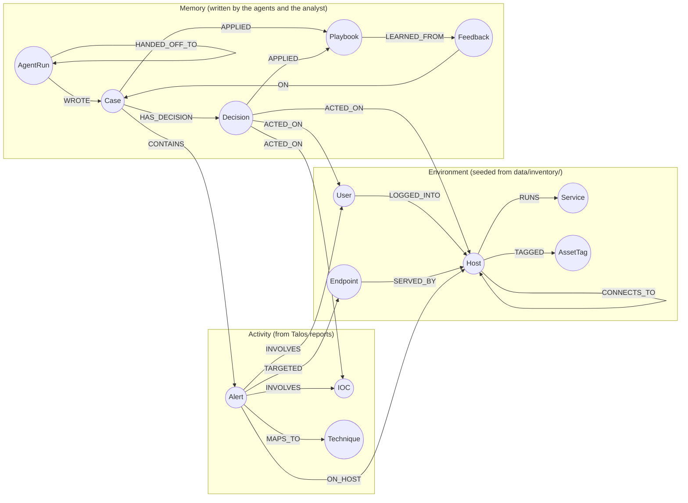

# Argus SOC graph layer

Workstream B (Md Adnan Afzal). This is the graph data model and every query the agents run,
written for the submission README (the "graph data model" and "Cypher queries / algorithms"
items). Everything here is the code itself: the Cypher blocks are copied from
`read_queries.py`, `algorithm_queries.py` and `write_queries.py`, and a test
(`tests/graph/test_graph_readme.py`) fails if they drift apart.

## 1. Why a graph

An alert alone says little. What makes it urgent is how it connects: the account it used,
where that account can log in, whether that path reaches a crown-jewel database, and what
happened the last time this IP showed up. Argus SOC keeps all of that in **FalkorDB**, and
the three agents (Triage, Investigator, Responder) decide by querying it. Without the graph
there is no correlation, no attack path, no ranking, no memory and no handoff, so the
product stops working (the hackathon's "not decoration" rule).

- **One graph per tenant:** `tenant_acme`, `tenant_globex`. Every function takes `tenant`
  first and `core/tenant_registry.py` maps it to the graph name, so a typo can never create a
  new graph and no query ever crosses tenants.
- **All Cypher lives in `src/argus_soc/graph/`.** Agents, ingestor and API call the Python
  functions of the graph tools library (`from argus_soc import graph`).
- **Every value is a query parameter** (`$ioc`, `$case_id`, ...). Log lines and Talos evidence
  are attacker-controlled; they never become Cypher text.
- **Writes are single queries built on `MERGE`**, so a retried agent step changes nothing.
  FalkorDB runs a graph's writes one at a time, which makes each of them atomic.

## 2. Data model



The constants are in `graph_schema.py` (`Label`, `Rel`, `EDGES`, status enums); no other file
types a label as a string.

| Label | Key | Main properties |
|---|---|---|
| `Host` | `hostname` | `ip`, `os`, `zone` (dmz/app/data/corp), `criticality` 1-5, `isolated` (simulated); memory: `targeted_case_ids`, `last_targeted_at` |
| `User` | `username` | `role`, `department`, `privileged`, `disabled` (simulated); memory: `suspected_compromised`, `suspected_at`, `suspect_case_id` |
| `Service` | `name` | `port`, `exposed` |
| `Endpoint` | `path` + `app` | (created from Talos `affected_endpoints`) |
| `AssetTag` | `name` | `crown-jewel` marks the hosts an attacker must not reach |
| `Alert` | `incident_id` | `domain`, `category`, `severity`, `confidence`, `succeeded`, `summary`, `evidence` (JSON), `recommended_actions`, `talos_created_at`, `ingested_at`, `status` (new/cased) |
| `IOC` | `type` + `value` | `verdict` (unknown/malicious/benign), `owner`, `seen_case_ids`, `first_seen`, `last_seen` |
| `Technique` | `mitre_id` | `name`, `tactic` |
| `Case` | `id` | `status`, `priority`, `category`, `opened_at`, `updated_at`, `closed_at`, `claimed_by`, `claimed_at`, `findings` (JSON), `verdict`, `closed_reason` |
| `Decision` | `id` | `rule_id`, `actions`, `needs_approval`, `reason`, `explanation`, `evidence` (JSON), `outcome` (pending/approved/rejected/auto), `agent`, `previous_priority` (case priority before the decision, GAP-5), `created_at` |
| `Feedback` | `id` | `verdict` (approve/reject/benign), `note`, `analyst`, `created_at` |
| `Playbook` | `name` + `version` | `condition` (JSON: category + `ioc_in`), `action` (auto_close), `active`, `created_at` |
| `AgentRun` | `id` | `agent`, `worker`, `case_id`, `at`, `summary`, `handed_to`, `tool_calls` (JSON) |

**Case statuses:** `new` → `triaged` → `investigated` → `awaiting_approval` → `closed`, or
`auto_closed` straight from Triage when a playbook matches.

**Indexes** (per tenant graph, `index_setup.py`): `Alert.incident_id`, `Host.hostname`,
`User.username`, `IOC.value`, `Case.id`, `Case.status`, `Playbook.active`. `EXPLAIN` on a
host lookup shows `Node By Index Scan`.

## 3. How the graph is memory (Track 02)

| Kind | Where it lives | Written by | Read by |
|---|---|---|---|
| **Episodic** | Closed `Case`s with their alerts, verdict and analyst notes | agents, analyst | Q4 `recall` |
| **Semantic** | `Host.targeted_case_ids`, `User.suspected_compromised`, `IOC.verdict`/`owner`/`seen_case_ids` | Investigator (`record_semantic_facts`), analyst (`set_ioc_fact`) | `entity_facts` |
| **Procedural** | `Playbook` versions `LEARNED_FROM` a `Feedback` | `create_playbook_version` | `matching_playbook` |
| **Shared state / handoffs** | `Case.status` + `claimed_by`/`claimed_at`, `AgentRun` chain via `HANDED_OFF_TO` | every agent | `claim_case`, `list_activity` |

Agents keep nothing in process memory: a restarted agent reads the case from the graph and
continues. Counts are stored as lists of case ids, never as counters, so writing the same fact
twice changes nothing ("times targeted" = `size(targeted_case_ids)`).

## 4. The queries

### Q1 Blast radius (`read_queries.blast_radius`)

Hosts hit by alerts involving an IOC, the accounts in those alerts, and every host those
accounts can log into. Most critical host first.

<!-- cypher: read_queries._BLAST_RADIUS -->
```cypher
MATCH (:IOC {value: $ioc})<-[:INVOLVES]-(a:Alert)-[:ON_HOST]->(h:Host)
OPTIONAL MATCH (a)-[:INVOLVES]->(u:User)
OPTIONAL MATCH (u)-[:LOGGED_INTO]->(r:Host)
WITH h, collect(DISTINCT a.incident_id) AS alerts, collect(DISTINCT u.username) AS accounts,
     collect(DISTINCT r.hostname) AS reached
RETURN h.hostname AS host, coalesce(h.criticality, 1) AS criticality, accounts,
       reached AS reached_hosts, size(alerts) AS alerts
```

### Q2 Paths to crown jewels (`algorithm_queries.paths_to_crown_jewels`)

FalkorDB's **`algo.SPpaths`** finds the shortest paths over network links and account logins
in either direction (a user who logs into two hosts links them). The usual `shortestPath()`
can't do this in FalkorDB: it only follows edge direction. On Acme it returns
`bastion-01 → app-02 → db-prod-01`; `web-01` has no path.

<!-- cypher: algorithm_queries._PATHS -->
```cypher
MATCH (src:Host {hostname: $host}),
      (dst:Host)-[:TAGGED]->(:AssetTag {name: $tag})
WHERE dst <> src
CALL algo.SPpaths({sourceNode: src, targetNode: dst,
                    relTypes: ['CONNECTS_TO', 'LOGGED_INTO'],
                    relDirection: 'both', maxLen: $max_hops, pathCount: $count})
YIELD path
RETURN [n IN nodes(path) | coalesce(n.hostname, n.username)] AS names, length(path) AS hops
```

### Q3 Which host to isolate (`algorithm_queries.rank_hosts`)

FalkorDB's **`algo.betweenness`** over the host network: a host that many paths cross is the
best single place to cut an attacker off. Score = (betweenness + 1) × criticality, scaled so
the top host is 1.0. On scenario 1, `bastion-01` ranks first.

<!-- cypher: algorithm_queries._CASE_HOSTS -->
```cypher
MATCH (:Case {id: $case_id})-[:CONTAINS]->(:Alert)-[:ON_HOST]->(h:Host)
RETURN DISTINCT h.hostname AS host, coalesce(h.criticality, 1) AS criticality
```

<!-- cypher: algorithm_queries._BETWEENNESS -->
```cypher
CALL algo.betweenness({nodeLabels: ['Host'], relationshipTypes: ['CONNECTS_TO']})
YIELD node, score
WHERE node.hostname IN $hosts
RETURN node.hostname AS host, score
```

### Q4 Recall (`read_queries.recall`)

Closed cases involving any of these IOCs, hosts or users, with the verdict and the latest
analyst note (newest first, at most 5). This is how Triage remembers that `10.0.5.20` was the
internal pentest scanner.

<!-- cypher: read_queries._RECALL -->
```cypher
MATCH (c:Case)-[:CONTAINS]->(:Alert)-[:INVOLVES]->(i:IOC)
WHERE c.status IN $closed AND i.value IN $iocs
RETURN c.id AS case_id, c.verdict AS verdict, c.closed_at AS closed_at
UNION
MATCH (c:Case)-[:CONTAINS]->(:Alert)-[:ON_HOST]->(h:Host)
WHERE c.status IN $closed AND h.hostname IN $hosts
RETURN c.id AS case_id, c.verdict AS verdict, c.closed_at AS closed_at
UNION
MATCH (c:Case)-[:CONTAINS]->(:Alert)-[:INVOLVES]->(u:User)
WHERE c.status IN $closed AND u.username IN $users
RETURN c.id AS case_id, c.verdict AS verdict, c.closed_at AS closed_at
```

### Q5 Linked alerts (`read_queries.linked_alerts`)

Other live alerts sharing an **IOC or a user** with this one (within a time window, checked in
Python). A shared host alone does not link: two attackers can hit the same web server.
Alerts already in a closed case are never returned, so a dealt-with alert can't be pulled into
a new case.

<!-- cypher: read_queries._LINKED -->
```cypher
MATCH (a:Alert {incident_id: $id})-[:INVOLVES]->(shared)
      <-[:INVOLVES]-(b:Alert)
WHERE b <> a
OPTIONAL MATCH (b)<-[:CONTAINS]-(done:Case) WHERE done.status IN $closed
WITH a, b, count(done) AS closed_cases
WHERE closed_cases = 0
RETURN DISTINCT b.incident_id AS id, b.talos_created_at AS at, a.talos_created_at AS origin
```

### Q6 Explain a decision (`read_queries.explain_decision`)

The decision with its case, alerts, `ACTED_ON` targets, the attack path stored in the case
findings, the playbook it `APPLIED` and the case that playbook was `LEARNED_FROM`. It starts
from:

<!-- cypher: read_queries._DECISION_CASE -->
```cypher
MATCH (c:Case)-[:HAS_DECISION]->(:Decision {id: $id})
OPTIONAL MATCH (c)-[:APPLIED]->(p:Playbook)
RETURN c.id AS case_id, c.findings AS findings, p.name AS case_pb_name,
       p.version AS case_pb_version
```

### Writes the agents depend on

**Ingest a Talos report** (`upsert_alert_from_report`): one `MERGE` fans out to hosts, users,
IOCs, endpoints and techniques. The same report twice is one alert.

<!-- cypher: write_queries._UPSERT_ALERT -->
```cypher
MERGE (a:Alert {incident_id: $incident_id})
ON CREATE SET a.status = 'new', a.ingested_at = $now
SET a.domain = $domain, a.category = $category, a.severity = $severity,
    a.confidence = $confidence, a.succeeded = $succeeded, a.summary = $summary,
    a.evidence = $evidence, a.recommended_actions = $recommended_actions,
    a.talos_created_at = $talos_created_at
WITH a
FOREACH (h IN $hosts |
    MERGE (n:Host {hostname: h}) ON CREATE SET n.isolated = false, n.targeted_case_ids = [], n.criticality = 1
    MERGE (a)-[:ON_HOST]->(n))
FOREACH (u IN $users |
    MERGE (n:User {username: u}) ON CREATE SET n.disabled = false, n.suspected_compromised = false
    MERGE (a)-[:INVOLVES]->(n))
FOREACH (ip IN $source_ips |
    MERGE (n:IOC {type: 'ip', value: ip}) ON CREATE SET n.verdict = 'unknown', n.seen_case_ids = [], n.first_seen = $now
    SET n.last_seen = $now
    MERGE (a)-[:INVOLVES]->(n))
FOREACH (p IN $endpoints |
    MERGE (n:Endpoint {path: p, app: $app})
    MERGE (a)-[:TARGETED]->(n))
FOREACH (t IN $techniques |
    MERGE (n:Technique {mitre_id: t.mitre_id})
    SET n.name = coalesce(t.name, n.name), n.tactic = coalesce(t.tactic, n.tactic)
    MERGE (a)-[:MAPS_TO]->(n))
RETURN a.incident_id AS incident_id
```

**Open or join a case** (`open_or_join_case`): joins the open case that already holds one of
the alerts, or creates the next case id in the same query. Alerts already in a closed case are
left out.

<!-- cypher: write_queries._OPEN_OR_JOIN -->
```cypher
MATCH (a:Alert) WHERE a.incident_id IN $ids
OPTIONAL MATCH (a)<-[:CONTAINS]-(done:Case) WHERE done.status IN $closed
WITH a, count(done) AS closed_cases
WHERE closed_cases = 0
WITH collect(a) AS alerts, collect(a.incident_id) AS eligible
WHERE size(alerts) > 0

OPTIONAL MATCH (open:Case)-[:CONTAINS]->(x:Alert)
WHERE x.incident_id IN eligible AND open.status IN $open_statuses
WITH alerts, open ORDER BY open.id LIMIT 1
OPTIONAL MATCH (any:Case)
WITH alerts, open, coalesce(max(any.id), 0) + 1 AS next_id
MERGE (c:Case {id: coalesce(open.id, next_id)})
ON CREATE SET c.status = 'new', c.priority = $priority, c.opened_at = $now,
              c.findings = '{}'
SET c.updated_at = $now
WITH c, alerts
UNWIND alerts AS a
MERGE (c)-[:CONTAINS]->(a)
SET a.status = 'cased', c.category = coalesce(c.category, a.category)
RETURN DISTINCT c.id AS id
```

**Claim a case** (`claim_case`): how several agent workers share the work without a queue
(G11). The claim expires, so a crashed worker's case is picked up again.

<!-- cypher: write_queries._CLAIM -->
```cypher
MATCH (c:Case {status: $status})
WHERE c.claimed_by IS NULL OR c.claimed_at < $expired_before
WITH c ORDER BY c.updated_at ASC, c.id ASC LIMIT 1
SET c.claimed_by = $agent, c.claimed_at = $now
RETURN c.id AS id
```

**Remember** (`record_semantic_facts`): written by the Investigator, read back by Triage next
time, idempotent.

<!-- cypher: write_queries._SEMANTIC_FACTS -->
```cypher
MATCH (c:Case {id: $case_id})
FOREACH (name IN $hosts |
    MERGE (n:Host {hostname: name}) ON CREATE SET n.isolated = false, n.targeted_case_ids = [], n.criticality = 1
    FOREACH (_ IN CASE WHEN NOT $case_id IN coalesce(n.targeted_case_ids, []) THEN [1] ELSE [] END |
        SET n.targeted_case_ids = coalesce(n.targeted_case_ids, []) + $case_id,
            n.last_targeted_at = $now))
FOREACH (value IN $iocs |
    MERGE (n:IOC {type: 'ip', value: value}) ON CREATE SET n.verdict = 'unknown', n.seen_case_ids = [], n.first_seen = $now
    FOREACH (_ IN CASE WHEN NOT $case_id IN coalesce(n.seen_case_ids, []) THEN [1] ELSE [] END |
        SET n.seen_case_ids = coalesce(n.seen_case_ids, []) + $case_id))
FOREACH (name IN $users |
    MERGE (n:User {username: name}) ON CREATE SET n.disabled = false, n.suspected_compromised = false
    FOREACH (_ IN CASE WHEN coalesce(n.suspect_case_id, -1) <> $case_id THEN [1] ELSE [] END |
        SET n.suspected_compromised = true, n.suspected_at = $now,
            n.suspect_case_id = $case_id))
RETURN c.id AS id
```

**Learn from the analyst** (`record_feedback`, `create_playbook_version`): approve runs the
simulated actions and marks the IOCs malicious; benign marks them benign and a new playbook
version auto-closes the same pattern next time (scenario 2).

<!-- cypher: write_queries._RECORD_FEEDBACK -->
```cypher
MATCH (c:Case {id: $case_id})
CREATE (f:Feedback {id: $id, verdict: $verdict, note: $note, analyst: $analyst,
                       created_at: $now})-[:ON]->(c)
SET c.updated_at = $now,
    c.verdict = CASE WHEN $verdict = 'benign' THEN 'benign' ELSE c.verdict END
WITH c, f
OPTIONAL MATCH (c)-[:HAS_DECISION]->(d:Decision {outcome: 'pending'})
FOREACH (_ IN CASE WHEN d IS NOT NULL THEN [1] ELSE [] END | SET d.outcome = $outcome)
WITH c, f, d
OPTIONAL MATCH (d)-[:ACTED_ON]->(h:Host)
FOREACH (_ IN CASE WHEN h IS NOT NULL AND $approve THEN [1] ELSE [] END | SET h.isolated = true)
WITH DISTINCT c, f, d
OPTIONAL MATCH (d)-[:ACTED_ON]->(u:User)
FOREACH (_ IN CASE WHEN u IS NOT NULL AND $approve THEN [1] ELSE [] END | SET u.disabled = true)
WITH DISTINCT c, f
OPTIONAL MATCH (c)-[:CONTAINS]->(:Alert)-[:INVOLVES]->(i:IOC)
FOREACH (_ IN CASE WHEN i IS NOT NULL AND $ioc_verdict IS NOT NULL THEN [1] ELSE [] END |
    SET i.verdict = $ioc_verdict)
RETURN DISTINCT f.id AS id
```

<!-- cypher: write_queries._CREATE_PLAYBOOK -->
```cypher
MATCH (f:Feedback {id: $feedback_id})
OPTIONAL MATCH (old:Playbook {condition: $condition})
WITH f, collect(old) AS olds, max(old.version) AS top
WITH f, olds, coalesce(top, 0) + 1 AS version,
     CASE WHEN size(olds) > 0 THEN olds[0].name ELSE $default_name END AS name
FOREACH (o IN olds | SET o.active = false)
CREATE (p:Playbook {name: name, version: version, condition: $condition,
                       action: $action, active: true, created_at: $now})
       -[:LEARNED_FROM]->(f)
RETURN p.name AS name, p.version AS version
```

## 5. MCP tools (Track 01)

`mcp_server.py` exposes the six read functions (Q1–Q5 and `entity_facts`) over MCP stdio for
the Investigator's deep dive: the LLM sees their names, one-line descriptions and argument
schemas and chooses which to call. No write is exposed; `tenant` is set by code; results are
cut to 4 000 characters. Start it with `python -m argus_soc.graph.mcp_server`.

## 6. Run it

```bash
docker compose up -d --build          # FalkorDB + seed (indexes, Acme and Globex inventories)
python scripts/seed_tenants.py        # again by hand: safe, changes nothing
python scripts/reset_demo.py --yes    # wipe both tenants and reseed
pytest -rs                            # graph tests; the live ones need FalkorDB on 127.0.0.1
```

Browse the graph at http://127.0.0.1:3000 (FalkorDB Browser), graph `tenant_acme`.
